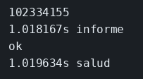

# Cuando el trabajo es CPU

El concepto está en [CPU y otros runtimes](../../labs/M01-node-en-microservicios/01-cpu-y-otros-runtimes.md).

## Dónde poner el foco

`/informe` calcula un Fibonacci en el mismo hilo que atiende `/salud`. La ruta es `async`, pero dentro no hay ningún `await`, así que el hilo no se suelta y `/salud` espera a que el cálculo termine.

## Archivos

| Archivo | Papel |
|---------|-------|
| `cpu.mjs` | Cálculo largo en el proceso que también responde `/salud` |

## El código

### `cpu.mjs`

```js
// fib(40) corre en el mismo hilo que atiende /salud. La función del
// servidor es async y no hay ningún await: el cálculo sigue hasta el
// final antes de que el bucle pueda escribir `ok`. Mira si /salud
// se adelanta al número o espera con él.
import { createServer } from 'node:http';

function fib(n) {
  if (n <= 1) return n;
  return fib(n - 1) + fib(n - 2);
}

const server = createServer(async (req, res) => {
  if (req.url === '/informe') {
    // 40 es bastante para que la pausa se mida en el curl. El resultado
    // cabe en un número de JavaScript y la respuesta es ese texto.
    res.end(String(fib(40)));
    return;
  }
  res.end('ok');
});

server.listen(3001, () => console.log('cpu en 3001'));
```

## Qué hacer

Si el ejemplo de I/O sigue en el puerto 3001, páralo antes.

```bash
cd ejemplos/01-cpu-bloquea
node cpu.mjs
```

En otra terminal:

```bash
curl -s -w '\n%{time_total}s informe\n' http://127.0.0.1:3001/informe &
curl -s -w '\n%{time_total}s salud\n' http://127.0.0.1:3001/salud &
wait
```

## Qué observar

Las dos peticiones salen a la vez y `/salud` no se adelanta: espera a que `fib(40)` termine. El trabajo es CPU en el hilo del proceso. Una espera de red, como el temporizador del ejemplo de I/O, dejaría responder `/salud` mientras el plazo sigue abierto. Node encaja en un borde con mucha conexión y poca CPU por petición; un cálculo largo como este informe ocupa el proceso hasta el final. Java puede llevar ese trabajo a otro hilo, Python a otro proceso y Go repartirlo entre goroutines.

## Qué validar

`/informe` responde `102334155`. `/salud` responde `ok` después, con un tiempo parecido al del informe.


