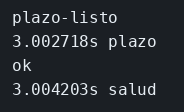
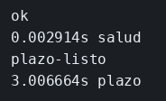

# I/O no bloqueante

El concepto está en [I/O no bloqueante](../../labs/M01-node-en-microservicios/00-io-no-bloqueante.md).

## Dónde poner el foco

Los dos programas esperan tres segundos antes de responder `/plazo`. En `bloqueante.mjs` esa espera es un bucle en el hilo, así que `/salud` no puede salir hasta que el bucle acaba. En `red.mjs` la espera es un temporizador, el mismo papel que una respuesta de red que todavía no ha llegado, y `/salud` responde enseguida porque el hilo quedó libre.

## Archivos

| Archivo | Papel |
|---------|-------|
| `bloqueante.mjs` | Espera de `/plazo` ocupando el hilo con un bucle |
| `red.mjs` | Espera de `/plazo` registrada con un temporizador |

## El código

### `bloqueante.mjs`

```js
// La espera de /plazo ocurre dentro del único hilo. Mientras el bucle
// no termina, el proceso no vuelve a mirar la cola de peticiones: /salud
// llega y se queda esperando. Fíjate en el while, no en el texto de la respuesta.
import { createServer } from 'node:http';

const server = createServer((req, res) => {
  if (req.url === '/plazo') {
    const hasta = Date.now() + 3000;
    // Tres segundos de CPU vacía. El temporizador devolvería el control;
    // este bucle lo retiene hasta que el reloj pasa de `hasta`.
    while (Date.now() < hasta) {}
    res.end('plazo-listo');
    return;
  }
  res.end('ok');
});

server.listen(3001, () => console.log('bloqueante en 3001'));
```

### `red.mjs`

```js
// La espera de /plazo queda anotada y el hilo se suelta. /salud puede
// responder mientras el plazo sigue abierto. El temporizador ocupa el
// lugar de una respuesta de red que todavía no ha llegado.
import { createServer } from 'node:http';

const server = createServer((req, res) => {
  if (req.url === '/plazo') {
    // Al registrar el plazo la función vuelve enseguida. La respuesta
    // se cierra tres segundos después, en otro turno del bucle.
    setTimeout(() => res.end('plazo-listo'), 3000);
    // Sin este return, la misma petición también escribiría `ok`.
    return;
  }
  res.end('ok');
});

server.listen(3001, () => console.log('red en 3001'));
```

## Qué hacer

Solo uno de los dos puede usar el puerto 3001. Primero el bucle:

```bash
cd ejemplos/01-io-no-bloqueante
node bloqueante.mjs
```

En otra terminal:

```bash
curl -s -w '\n%{time_total}s plazo\n' http://127.0.0.1:3001/plazo &
curl -s -w '\n%{time_total}s salud\n' http://127.0.0.1:3001/salud &
wait
```

Para el proceso (Ctrl+C) y repite con `node red.mjs` y los mismos `curl`.

## Qué observar

Con el bucle, la línea de `salud` tarda cerca de 3 segundos, igual que `plazo`: el `while` retiene el hilo y `/salud` espera aunque la petición ya haya llegado. Con el temporizador, `salud` imprime `ok` al momento y `plazo-listo` llega unos 3 segundos después, porque `setTimeout` anota el plazo y devuelve el control.

## Qué validar

Con `bloqueante.mjs`, los dos cuerpos son `plazo-listo` y `ok`, y las dos líneas de tiempo rondan los 3s. Con `red.mjs`, `salud` sale enseguida con `ok` y `plazo` sale después con `plazo-listo`.




