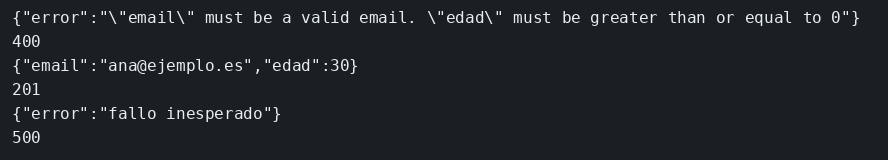

# Joi y códigos de estado

El concepto está en [Joi y códigos de error](../../labs/M02-apis-rest-express/01-joi-y-errores.md).

## Dónde poner el foco

Joi rechaza el cuerpo antes de guardarlo, y el middleware de cuatro argumentos traduce ese fallo y la excepción de `/romper` a un código HTTP.

## Archivos

| Archivo | Papel |
|---------|-------|
| `server.mjs` | Esquema del contacto, validación y respuesta de error |
| `package.json` | Arranque con `npm start` y las dependencias `express` y `joi` |

## El código

### `server.mjs`

```js
// El cuerpo se juzga antes de entrar en el array. El fallo de Joi y
// la excepción de /romper salen por el mismo middleware, con distinto
// código. Mira el status que viaja en el error y la función de cuatro
// argumentos que lo convierte en HTTP.
import express from 'express';
import Joi from 'joi';

const app = express();
app.use(express.json());

const contactos = [];

const esquema = Joi.object({
  email: Joi.string().email().required(),
  edad: Joi.number().integer().min(0).max(120).required(),
});

function validar(req, res, next) {
  // abortEarly en false junta todos los campos malos en una sola respuesta.
  // convert en false exige que edad ya sea número: una cadena numérica no pasa.
  const { error, value } = esquema.validate(req.body, { abortEarly: false, convert: false });
  if (error) {
    // next(error) deja la respuesta al middleware final. El 400 marca fallo del cliente.
    next(Object.assign(new Error(error.message), { status: 400 }));
    return;
  }
  req.body = value;
  next();
}

app.post('/contactos', validar, (req, res) => {
  contactos.push(req.body);
  res.status(201).json(req.body);
});

app.get('/romper', () => {
  // Express 5 entrega esta excepción al middleware de error. El proceso sigue.
  throw new Error('fallo inesperado');
});

// Cuatro argumentos: Express solo entonces la trata como manejador de errores.
// Un throw sin status sale como 500.
app.use((err, req, res, next) => {
  res.status(err.status || 500).json({ error: err.message });
});

app.listen(3001, () => console.log('contactos en 3001'));
```

## Qué hacer

Si otro ejemplo sigue en el puerto 3001, páralo antes.

```bash
cd ejemplos/02-joi-errores
npm install
npm start
```

En otra terminal:

```bash
curl -s -w '\n%{http_code}\n' -H 'Content-Type: application/json' \
  -d '{"email":"no-es","edad":-1}' http://127.0.0.1:3001/contactos
curl -s -w '\n%{http_code}\n' -H 'Content-Type: application/json' \
  -d '{"email":"ana@ejemplo.es","edad":30}' http://127.0.0.1:3001/contactos
curl -s -w '\n%{http_code}\n' http://127.0.0.1:3001/romper
```

## Qué observar

El primer POST responde 400 y el campo `error` trae el mensaje de Joi: el email no es válido y la edad queda por debajo de 0. Los dos fallos viajan juntos porque `abortEarly` está en false. El segundo POST responde 201 con el contacto. `/romper` responde 500 con `fallo inesperado`. El proceso sigue en marcha después del 500: Express 5 entregó la excepción al middleware.

## Qué validar

400 en el cuerpo inválido, 201 con `{"email":"ana@ejemplo.es","edad":30}`, y 500 con `fallo inesperado`.


