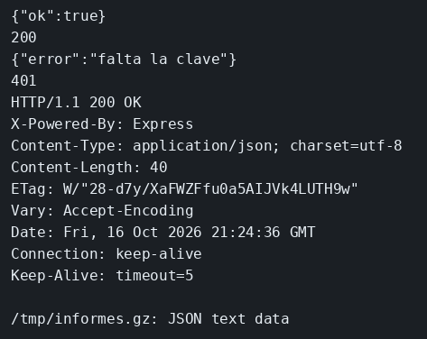

# Middleware

El concepto está en [Middleware](../../labs/M02-apis-rest-express/02-middleware.md).

## Dónde poner el foco

Toda petición pasa por el registro y por la compresión. La clave `x-api-key` solo se exige en `/informes`, de modo que `/salud` responde sin credencial y sigue sirviendo para saber si el proceso está arriba.

## Archivos

| Archivo | Papel |
|---------|-------|
| `server.mjs` | morgan, compression y la comprobación de clave en una ruta |
| `package.json` | Arranque con `npm start` y las dependencias `express`, `morgan` y `compression` |

## El código

### `server.mjs`

```js
// morgan y compression rodean todas las rutas. La clave solo entra
// en /informes: /salud tiene que responder sin ella. Mira qué función
// va en app.use y cuál va como argumento de una sola ruta.
import express from 'express';
import morgan from 'morgan';
import compression from 'compression';

const app = express();
// Una línea por petición, con método, ruta y código, sin repetir el log en cada handler.
app.use(morgan('tiny'));
// Negocia gzip si el cliente manda Accept-Encoding. Si no lo manda, el cuerpo sigue en JSON claro.
app.use(compression());

const informes = [{ id: 'i1', titulo: 'cierre de marzo' }];

function apiKey(req, res, next) {
  if (req.header('x-api-key') !== 'clave-informes') {
    res.status(401).json({ error: 'falta la clave' });
    // El return corta la cadena: sin él, next() ejecutaría también el handler.
    return;
  }
  next();
}

app.get('/salud', (req, res) => {
  res.json({ ok: true });
});

app.get('/informes', apiKey, (req, res) => {
  res.json(informes);
});

app.listen(3001, () => console.log('informes en 3001'));
```

## Qué hacer

Si otro ejemplo sigue en el puerto 3001, páralo antes.

```bash
cd ejemplos/02-middleware
npm install
npm start
```

En otra terminal:

```bash
curl -s -w '\n%{http_code}\n' http://127.0.0.1:3001/salud
curl -s -w '\n%{http_code}\n' http://127.0.0.1:3001/informes
curl -s -D - -o /tmp/informes.gz -H 'x-api-key: clave-informes' -H 'Accept-Encoding: gzip' \
  http://127.0.0.1:3001/informes
echo
file /tmp/informes.gz
```

## Qué observar

`/salud` responde 200 sin clave. `/informes` sin clave responde 401 y el cuerpo dice `falta la clave`. Con `x-api-key: clave-informes` y `Accept-Encoding: gzip`, la cabecera `Content-Encoding` es `gzip`: compression solo negocia el formato si el cliente lo pide. En la terminal del servidor, morgan escribe una línea por cada petición.

## Qué validar

200 en `/salud`, 401 en `/informes` sin clave, y con la clave `file /tmp/informes.gz` describe el cuerpo como gzip.


