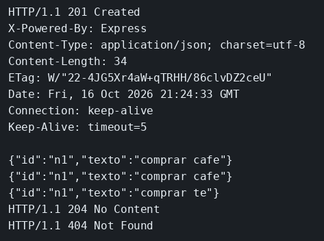

# Rutas HTTP con Express

El concepto está en [Rutas y verbos HTTP](../../labs/M02-apis-rest-express/00-rutas-http.md).

## Dónde poner el foco

La misma nota pasa por alta, lectura, cambio y borrado. Cada verbo hace una de esas cosas, y el código HTTP dice si se creó, si se sustituyó o si el id ya no está.

## Archivos

| Archivo | Papel |
|---------|-------|
| `server.mjs` | Notas en memoria: leer, crear, sustituir y borrar |
| `package.json` | Arranque con `npm start` y la dependencia `express` |

## El código

### `server.mjs`

```js
// Una nota en memoria y un verbo por acción. El código HTTP dice si
// la nota se creó, si ya no está o si el id no existía. Al reiniciar
// el proceso el array vuelve a vacío: aquí se mira el verbo, no la
// persistencia.
import express from 'express';

const app = express();
// Sin esto, req.body llega indefinido y la nota se guardaría vacía.
app.use(express.json());

const notas = [];

app.get('/salud', (req, res) => {
  res.json({ ok: true });
});

app.get('/notas', (req, res) => {
  res.json(notas);
});

app.get('/notas/:id', (req, res) => {
  const nota = notas.find((n) => n.id === req.params.id);
  if (!nota) {
    // 404 distingue «ese id no está» de un fallo del proceso.
    res.status(404).json({ error: 'nota no encontrada' });
    return;
  }
  res.json(nota);
});

app.post('/notas', (req, res) => {
  const nota = { id: req.body.id, texto: req.body.texto };
  notas.push(nota);
  // 201: el recurso acaba de crearse. 200 solo diría que la petición fue bien.
  res.status(201).json(nota);
});

app.put('/notas/:id', (req, res) => {
  const nota = notas.find((n) => n.id === req.params.id);
  if (!nota) {
    res.status(404).json({ error: 'nota no encontrada' });
    return;
  }
  // El objeto ya está dentro del array: cambiar texto sustituye la nota.
  nota.texto = req.body.texto;
  res.json(nota);
});

app.delete('/notas/:id', (req, res) => {
  const i = notas.findIndex((n) => n.id === req.params.id);
  if (i === -1) {
    res.status(404).json({ error: 'nota no encontrada' });
    return;
  }
  notas.splice(i, 1);
  // 204 y cuerpo vacío: ya no hay recurso que devolver.
  res.status(204).end();
});

app.listen(3001, () => console.log('notas en 3001'));
```

## Qué hacer

Si otro ejemplo sigue en el puerto 3001, páralo antes.

```bash
cd ejemplos/02-rutas-http
npm install
npm start
```

En otra terminal:

```bash
curl -s -D - -H 'Content-Type: application/json' -d '{"id":"n1","texto":"comprar cafe"}' http://127.0.0.1:3001/notas
echo
curl -s http://127.0.0.1:3001/notas/n1
echo
curl -s -X PUT -H 'Content-Type: application/json' -d '{"texto":"comprar te"}' http://127.0.0.1:3001/notas/n1
echo
curl -s -D - -o /dev/null -X DELETE http://127.0.0.1:3001/notas/n1
curl -s -D - -o /dev/null http://127.0.0.1:3001/notas/n1
```

## Qué observar

El POST responde 201 y devuelve la nota con `comprar cafe`. El GET de `n1` trae ese mismo texto. El PUT lo sustituye por `comprar te` y devuelve la nota ya cambiada. El DELETE responde 204 sin cuerpo. El GET final responde 404 con `nota no encontrada`. Un GET a `/notas` antes del alta devuelve `[]`, porque el array empieza vacío y se pierde al reiniciar el proceso.

## Qué validar

201 con `{"id":"n1","texto":"comprar cafe"}`, después el texto `comprar te`, después 204 y un 404.


