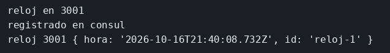

# Consul

El concepto está en [Consul](../../labs/M03-comunicacion-entre-servicios/05-consul.md).

## Dónde poner el foco

`reloj` no publica su puerto en el host: se registra en Consul y el cliente llama a la dirección que Consul marca como sana.

## Archivos

| Archivo | Papel |
|---------|-------|
| `reloj/server.mjs` | Sirve `/hora` y `/salud`, y se registra con un check HTTP |
| `cliente/cliente.mjs` | Pregunta el servicio `reloj` en passing y pide la hora |
| `reloj/package.json` | Dependencia `express` del reloj |
| `cliente/package.json` | Cliente sin dependencias; usa el `fetch` de Node |
| `reloj/Dockerfile` | Imagen del reloj, a la escucha en el 3001 |
| `cliente/Dockerfile` | Imagen del cliente; solo copia `cliente.mjs` |
| `docker-compose.yml` | Consul con la UI, el reloj y el cliente |

## El código

### `reloj/server.mjs`

```js
// Al escuchar, el reloj se apunta en Consul con el nombre `reloj` y
// un check a /salud. La dirección es el nombre del servicio en Compose,
// porque el cliente corre en otro contenedor. Mira Address, Port y el check.
import express from 'express';

const consul = process.env.CONSUL_HTTP_ADDR;

const app = express();
app.get('/salud', (req, res) => {
  res.json({ ok: true });
});
app.get('/hora', (req, res) => {
  res.json({ hora: new Date().toISOString(), id: 'reloj-1' });
});

async function registrar() {
  const respuesta = await fetch(`${consul}/v1/agent/service/register`, {
    method: 'PUT',
    headers: { 'content-type': 'application/json' },
    body: JSON.stringify({
      Name: 'reloj',
      ID: 'reloj-1',
      Address: 'reloj',
      Port: 3001,
      Check: { HTTP: 'http://reloj:3001/salud', Interval: '5s' },
    }),
  });
  if (!respuesta.ok) throw new Error(`registro ${respuesta.status}`);
  console.log('registrado en consul');
}

// 0.0.0.0: otro contenedor de la red tiene que poder abrir el 3001.
// El bucle existe porque Consul puede no aceptar el registro al primer intento.
app.listen(3001, '0.0.0.0', async () => {
  console.log('reloj en 3001');
  for (let i = 0; i < 15; i += 1) {
    try {
      await registrar();
      return;
    } catch (err) {
      if (i === 14) throw err;
      await new Promise((r) => setTimeout(r, 1000));
    }
  }
});
```

### `cliente/cliente.mjs`

```js
// El puerto del reloj no está escrito aquí. Cada vuelta pregunta a Consul
// quién está passing y llama a la dirección que devuelve. Mira el query
// `passing` y el uso de Address y Port del catálogo.
const consul = process.env.CONSUL_HTTP_ADDR;

for (let i = 0; i < 20; i += 1) {
  const respuesta = await fetch(`${consul}/v1/health/service/reloj?passing`);
  const lista = await respuesta.json();
  if (lista.length > 0) {
    const svc = lista[0].Service;
    const hora = await fetch(`http://${svc.Address}:${svc.Port}/hora`);
    console.log(svc.Address, svc.Port, await hora.json());
    process.exit(0);
  }
  // El registro ocurre después de arrancar el contenedor del reloj.
  await new Promise((r) => setTimeout(r, 1000));
}

console.error('nadie registrado');
process.exit(1);
```

## Qué hacer

```bash
cd ejemplos/03-consul
docker compose up --build
```

`docker compose up` sin `-d` deja los logs a la vista. El cliente termina solo cuando ha impreso la hora.

La UI de Consul está en http://127.0.0.1:8500. Para repetirlo: `docker compose down` y otra vez `docker compose up --build`.

## Qué observar

En los logs de `ms-reloj` aparece `registrado en consul` después de `reloj en 3001`. En los de `ms-reloj-cliente`, la línea trae `reloj`, el puerto `3001` y un JSON con `hora` e `id` `reloj-1`. Esa dirección sale del catálogo (`Address` y `Port`), no de una constante del cliente. En la UI, el servicio `reloj` está en passing porque el check llama a `http://reloj:3001/salud` cada 5 segundos.

## Qué validar

`registrado en consul` en el reloj, y en el cliente una línea con `reloj 3001` y `"id":"reloj-1"`.


