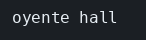

# EventEmitter

El concepto está en [EventEmitter](../../labs/M03-comunicacion-entre-servicios/00-event-emitter.md).

## Dónde poner el foco

El aviso `alarma` se emite sobre un objeto `bus` que vive en ese proceso, y quien hizo `on` sobre ese mismo objeto lo recibe. Otro proceso, aunque escuche el mismo nombre, tiene otro objeto y no se entera.

## Archivos

| Archivo | Papel |
|---------|-------|
| `mismo-proceso.mjs` | Emite `alarma` y lo escucha en el mismo proceso |
| `otro-proceso.mjs` | Escucha `alarma` en otro proceso y se queda en marcha |

## El código

### `mismo-proceso.mjs`

```js
// Quien escucha y quien emite comparten este objeto `bus`, en este
// proceso. El nombre `alarma` solo existe aquí. Mira que el oyente
// corre en el mismo turno que emit, y el programa termina al acabar.
import { EventEmitter } from 'node:events';

const bus = new EventEmitter();

bus.on('alarma', (aviso) => {
  console.log('oyente', aviso.zona);
});

bus.emit('alarma', { zona: 'hall' });
```

### `otro-proceso.mjs`

```js
// Este proceso tiene su propio `bus`. Registrar el mismo nombre no
// une los dos programas: no hay cola detrás de la cadena `alarma`.
// El intervalo vacío mantiene el proceso vivo para poder ver el silencio.
import { EventEmitter } from 'node:events';

const bus = new EventEmitter();

bus.on('alarma', (aviso) => {
  console.log('oyente', aviso.zona);
});

// Sin un manejador pendiente, Node saldría al terminar de registrar el oyente.
setInterval(() => {}, 1000);
```

## Qué hacer

```bash
cd ejemplos/03-event-emitter
node mismo-proceso.mjs
```

Imprime `oyente hall` y termina.

```bash
node otro-proceso.mjs
```

Déjalo en marcha. En otra terminal, desde la misma carpeta:

```bash
node mismo-proceso.mjs
```

## Qué observar

`mismo-proceso.mjs` imprime el aviso en su terminal porque `emit` y `on` usan el mismo `bus`, en el mismo turno. `otro-proceso.mjs` no imprime nada: su `bus` es otro objeto y la cadena `alarma` no es una cola. El `setInterval` vacío solo mantiene ese proceso vivo para que el silencio se pueda ver.

## Qué validar

La primera ejecución imprime `oyente hall` y el proceso acaba. Con los dos programas a la vez, esa línea sale solo en la terminal de `mismo-proceso.mjs`.


