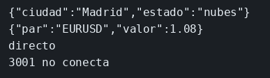

# Gateway

El concepto está en [Gateway](../../labs/M03-comunicacion-entre-servicios/06-gateway.md).

## Dónde poner el foco

El cliente solo habla con el puerto 8080. `/api/clima/hoy` se reenvía a `clima` y `/api/cotizaciones/usd` se reenvía a `cotizaciones`. Esos servicios no publican puerto, así que un `curl` directo a ellos no conecta.

## Archivos

| Archivo | Papel |
|---------|-------|
| `gateway/server.mjs` | Escucha el 8080 y reenvía cada ruta al servicio que corresponde |
| `clima/server.mjs` | Responde `/hoy` en el 3001 de la red interna |
| `cotizaciones/server.mjs` | Responde `/usd` en el 3002 de la red interna |
| `gateway/package.json` | Dependencia `express` del gateway |
| `clima/package.json` | Dependencia `express` de clima |
| `cotizaciones/package.json` | Dependencia `express` de cotizaciones |
| `gateway/Dockerfile` | Imagen del gateway; expone el 8080 |
| `clima/Dockerfile` | Imagen de clima; expone el 3001 |
| `cotizaciones/Dockerfile` | Imagen de cotizaciones; expone el 3002 |
| `docker-compose.yml` | Los tres servicios; en el host solo publica el 8080 |

## El código

### `gateway/server.mjs`

```js
// El cliente entra por el 8080. Cada ruta pública nombra un servicio de
// la red de Compose; el 3001 y el 3002 no se publican en el host. Mira
// los hostnames `clima` y `cotizaciones`, y que el estado se copia tal cual.
import express from 'express';

const app = express();

async function reenviar(res, url) {
  const respuesta = await fetch(url);
  const texto = await respuesta.text();
  // Se reenvían estado y cuerpo. El gateway no vuelve a interpretar el JSON.
  res.status(respuesta.status).type('application/json').send(texto);
}

app.get('/api/clima/hoy', async (req, res) => {
  await reenviar(res, 'http://clima:3001/hoy');
});

app.get('/api/cotizaciones/usd', async (req, res) => {
  await reenviar(res, 'http://cotizaciones:3002/usd');
});

app.listen(8080, '0.0.0.0', () => console.log('gateway en 8080'));
```

### `clima/server.mjs`

```js
// Este proceso solo conoce /hoy. El prefijo /api/clima lo pone el gateway.
// Escucha en 0.0.0.0 para que ese otro contenedor abra http://clima:3001
// en la red de Compose. Mira el puerto 3001 y la ruta corta.
import express from 'express';

const app = express();
app.get('/hoy', (req, res) => {
  res.json({ ciudad: 'Madrid', estado: 'nubes' });
});
app.listen(3001, '0.0.0.0', () => console.log('clima en 3001'));
```

### `cotizaciones/server.mjs`

```js
// Misma idea que clima, con otro puerto dentro de la red. 3002 solo lo
// usa el gateway al pedir /usd. El cliente de fuera llama a /api/cotizaciones/usd
// en el 8080 y no necesita saber este puerto.
import express from 'express';

const app = express();
app.get('/usd', (req, res) => {
  res.json({ par: 'EURUSD', valor: 1.08 });
});
app.listen(3002, '0.0.0.0', () => console.log('cotizaciones en 3002'));
```

## Qué hacer

```bash
cd ejemplos/03-gateway
docker compose up --build -d
curl -s http://127.0.0.1:8080/api/clima/hoy
echo
curl -s http://127.0.0.1:8080/api/cotizaciones/usd
echo
```

## Qué observar

Los dos `curl` al 8080 devuelven el JSON de cada servicio. El cliente no escribe el 3001 ni el 3002: Compose no publica esos puertos, y el gateway resuelve los nombres `clima` y `cotizaciones` dentro de su red. Un `curl` a `http://127.0.0.1:3001/hoy` no conecta.

## Qué validar

`{"ciudad":"Madrid","estado":"nubes"}` y `{"par":"EURUSD","valor":1.08}`.


