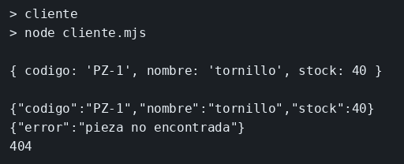

# gRPC y el GET equivalente

El concepto está en [gRPC y REST](../../labs/M03-comunicacion-entre-servicios/03-grpc.md).

## Dónde poner el foco

`GetPieza` está declarado en `pieza.proto` y se llama por el puerto 50051. El mismo dato, la pieza `PZ-1`, también sale por GET `/piezas/PZ-1` en el 3001. Los dos responden lo mismo; cambia el contrato con el que se pide.

## Archivos

| Archivo | Papel |
|---------|-------|
| `pieza.proto` | Contrato de la rpc `GetPieza` |
| `servidor.mjs` | Servicio gRPC y el GET equivalente, con la misma pieza |
| `cliente.mjs` | Llama a `GetPieza` con el código `PZ-1` |
| `package.json` | Scripts `servidor` y `cliente`; dependencias `@grpc/grpc-js`, `@grpc/proto-loader` y `express` |

## El código

### `pieza.proto`

```proto
// El contrato es este fichero. Cliente y servidor sacan GetPieza de aquí,
// no de una ruta. El número de cada campo es su etiqueta en el cable.
// Mira la rpc: un mensaje de id entra y un mensaje de pieza sale.
syntax = "proto3";
package inventario;

service Inventario {
  rpc GetPieza (PiezaId) returns (Pieza);
}

// El argumento es solo el código. Así la pregunta no rellena nombre ni stock.
message PiezaId {
  string codigo = 1;
}

message Pieza {
  string codigo = 1;
  string nombre = 2;
  int32 stock = 3;
}
```

### `servidor.mjs`

```js
// El mismo objeto `pieza` se sirve por dos contratos en un proceso:
// GetPieza en el 50051 y GET /piezas/:codigo en el 3001. Un código que
// no coincide es NOT_FOUND en gRPC y 404 en HTTP. Mira que el dato no cambia.
import grpc from '@grpc/grpc-js';
import protoLoader from '@grpc/proto-loader';
import express from 'express';

const def = protoLoader.loadSync('./pieza.proto', { keepCase: true, longs: String, defaults: true });
const proto = grpc.loadPackageDefinition(def).inventario;
const pieza = { codigo: 'PZ-1', nombre: 'tornillo', stock: 40 };

const grpcServer = new grpc.Server();
grpcServer.addService(proto.Inventario.service, {
  GetPieza: (call, callback) => {
    if (call.request.codigo !== pieza.codigo) {
      callback({ code: grpc.status.NOT_FOUND, message: 'pieza no encontrada' });
      return;
    }
    callback(null, pieza);
  },
});

// Sin TLS, igual que el cliente. 0.0.0.0 para aceptar la conexión en esa interfaz.
await new Promise((resolve, reject) => {
  grpcServer.bindAsync('0.0.0.0:50051', grpc.ServerCredentials.createInsecure(), (err) => {
    if (err) reject(err);
    else resolve();
  });
});
console.log('grpc en 50051');

const app = express();
app.get('/piezas/:codigo', (req, res) => {
  if (req.params.codigo !== pieza.codigo) {
    res.status(404).json({ error: 'pieza no encontrada' });
    return;
  }
  res.json(pieza);
});
app.listen(3001, () => console.log('rest en 3001'));
```

### `cliente.mjs`

```js
// La llamada sale del proto cargado, hacia el puerto gRPC. El canal
// queda abierto después de la respuesta: el proceso sale a propósito
// al terminar una consulta. Mira el código PZ-1 y el puerto 50051.
import grpc from '@grpc/grpc-js';
import protoLoader from '@grpc/proto-loader';

// keepCase deja los nombres como en el proto, alineados con el JSON del GET.
const def = protoLoader.loadSync('./pieza.proto', { keepCase: true, longs: String, defaults: true });
const proto = grpc.loadPackageDefinition(def).inventario;
const cliente = new proto.Inventario('127.0.0.1:50051', grpc.credentials.createInsecure());

cliente.GetPieza({ codigo: 'PZ-1' }, (err, respuesta) => {
  if (err) {
    console.error(err.message);
    process.exit(1);
  }
  console.log(respuesta);
  process.exit(0);
});
```

## Qué hacer

Si otro ejemplo sigue en el puerto 3001, páralo antes.

```bash
cd ejemplos/03-grpc
npm install
npm run servidor
```

En otra terminal, desde la misma carpeta:

```bash
npm run cliente
curl -s http://127.0.0.1:3001/piezas/PZ-1
echo
curl -s -w '\n%{http_code}\n' http://127.0.0.1:3001/piezas/PZ-9
```

## Qué observar

El cliente imprime `codigo` `PZ-1`, `nombre` `tornillo` y `stock` 40. El GET de `PZ-1` devuelve el mismo JSON. `PZ-9` responde 404 y `pieza no encontrada`. En gRPC, ese código ausente llega como error con el mensaje `pieza no encontrada`: para verlo, el argumento del cliente pasa a `PZ-9`. El contrato de la llamada gRPC es el proto; el del GET es el camino y el JSON. Los dos van sin TLS.

## Qué validar

El cliente muestra `PZ-1`, `tornillo` y `40`. El GET devuelve `{"codigo":"PZ-1","nombre":"tornillo","stock":40}`. `PZ-9` responde 404.


