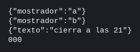

# HAProxy

El concepto está en [Gateway con HAProxy](../../labs/M03-comunicacion-entre-servicios/08-gateway-haproxy.md).

## Dónde poner el foco

El cliente solo habla con el puerto 8080. `/api/mostrador/turno` se reparte entre `mostrador-a` y `mostrador-b`. `/api/avisos/hoy` va a `avisos`. Esos servicios no publican puerto. HAProxy quita el prefijo público y, si un mostrador no responde `/salud`, deja de enviarle peticiones.

## Archivos

| Archivo | Papel |
|---------|-------|
| `haproxy.cfg` | Frontend en el 8080, una ACL por prefijo y un backend por servicio |
| `mostrador/server.mjs` | Responde `/turno` y `/salud` en el 3001 de su contenedor. `MOSTRADOR` vale `a` o `b` |
| `avisos/server.mjs` | Responde `/hoy` y `/salud` en el 3002 de su contenedor |
| `mostrador/package.json` | Dependencia `express` del mostrador |
| `avisos/package.json` | Dependencia `express` de avisos |
| `mostrador/Dockerfile` | Imagen del mostrador; expone el 3001 |
| `avisos/Dockerfile` | Imagen de avisos; expone el 3002 |
| `docker-compose.yml` | Dos copias del mostrador, avisos y HAProxy. En el host solo publica el 8080 |

## El código

### `haproxy.cfg`

```
global
    log stdout format raw local0 info
    maxconn 256

defaults
    mode http
    log global
    option httplog
    timeout connect 3s
    timeout client 10s
    timeout server 10s
    timeout check 1s
    retries 2
    option redispatch

frontend entrada
    bind *:8080
    # /salud lo responde este proceso. No llega a mostrador ni a avisos.
    monitor-uri /salud
    stats enable
    stats uri /stats
    stats refresh 5s

    # El prefijo elige el backend. El servicio no ve ese prefijo:
    # set-path está en el backend, después de la elección.
    acl es_mostrador path_beg /api/mostrador
    acl es_avisos path_beg /api/avisos
    use_backend mostrador if es_mostrador
    use_backend avisos if es_avisos

backend mostrador
    balance roundrobin
    option httpchk
    http-check send meth GET uri /salud
    http-request set-path %[path,regsub(^/api/mostrador/,/)]
    server a mostrador-a:3001 check inter 1s fall 2 rise 1
    server b mostrador-b:3001 check inter 1s fall 2 rise 1

backend avisos
    option httpchk
    http-check send meth GET uri /salud
    http-request set-path %[path,regsub(^/api/avisos/,/)]
    server avisos avisos:3002 check inter 1s fall 2 rise 1
```

### `mostrador/server.mjs`

```js
// Este proceso solo conoce /turno y /salud. El prefijo /api/mostrador
// lo quita HAProxy. MOSTRADOR distingue las dos copias: las dos escuchan
// el 3001 de su contenedor, y el host no publica ese puerto.
import express from 'express';

const mostrador = process.env.MOSTRADOR;
const app = express();

app.get('/salud', (req, res) => {
  res.json({ ok: true });
});

app.get('/turno', (req, res) => {
  res.json({ mostrador });
});

app.use((req, res) => {
  res.status(404).json({ error: 'no esta' });
});

app.listen(3001, '0.0.0.0', () => console.log(`mostrador ${mostrador} en 3001`));
```

### `avisos/server.mjs`

```js
// Este proceso solo conoce /hoy y /salud. El prefijo /api/avisos lo quita
// HAProxy. Escucha el 3002 de su contenedor. El host no publica ese puerto.
import express from 'express';

const app = express();

app.get('/salud', (req, res) => {
  res.json({ ok: true });
});

app.get('/hoy', (req, res) => {
  res.json({ texto: 'cierra a las 21' });
});

app.use((req, res) => {
  res.status(404).json({ error: 'no esta' });
});

app.listen(3002, '0.0.0.0', () => console.log('avisos en 3002'));
```

## Qué hacer

En un Codespace, lanza antes esto desde la raíz del repo. Sin ello HAProxy no alcanza a los servicios dentro de Compose (ver [Entorno](../../infra/README.md#codespace-contenedores-que-no-se-ven)):

```bash
bash scripts/red-docker-codespace.sh
```

```bash
cd ejemplos/03-haproxy
docker compose up --build -d
curl -s http://127.0.0.1:8080/api/mostrador/turno
echo
curl -s http://127.0.0.1:8080/api/mostrador/turno
echo
curl -s http://127.0.0.1:8080/api/avisos/hoy
echo
curl -s -o /dev/null -w '%{http_code}\n' --connect-timeout 2 http://127.0.0.1:3001/turno
```

## Qué observar

Los dos `curl` de `/api/mostrador/turno` devuelven mostradores distintos: HAProxy elige `a` y luego `b` porque `balance roundrobin` alterna conexiones nuevas. `/api/avisos/hoy` va siempre al mismo proceso. El cliente no escribe el 3001 ni el 3002. Compose no publica esos puertos, y el proxy resuelve `mostrador-a`, `mostrador-b` y `avisos` dentro de su red.

`/salud` en el 8080 lo contesta HAProxy. El cuerpo trae `Service ready.` En http://127.0.0.1:8080/stats los tres servidores están UP.

`docker stop ms-haproxy-mostrador-b`. Cuando en http://127.0.0.1:8080/stats el servidor `b` pasa a DOWN (unos segundos; `UP 1/2` es el check a medias), otro `curl` a `/api/mostrador/turno` sigue en `a`. `docker start ms-haproxy-mostrador-b` lo devuelve a UP.

## Qué validar

`{"mostrador":"a"}`, `{"mostrador":"b"}` y `{"texto":"cierra a las 21"}`. El `curl` al 3001 imprime `000`.

Si un `curl` al 8080 responde 503 y el log de `ms-haproxy` dice `Connection refused` hacia `mostrador-a`, los contenedores no se ven entre sí. Lanza `bash scripts/red-docker-codespace.sh` desde la raíz y vuelve a `docker compose up --build -d`.


