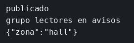

# Kafka

El concepto está en [Kafka](../../labs/M03-comunicacion-entre-servicios/02-kafka.md).

## Dónde poner el foco

El aviso queda en el topic `avisos`; el grupo `lectores` guarda hasta dónde ha leído, y leer no borra el mensaje.

## Archivos

| Archivo | Papel |
|---------|-------|
| `publicador.mjs` | Publica en el topic `avisos` y reintenta la conexión al broker |
| `consumidor.mjs` | Lee `avisos` con el grupo `lectores` |
| `package.json` | Scripts `publicar` y `consumir`, dependencia `kafkajs` |
| `docker-compose.yml` | Broker Kafka a la escucha en el puerto 9092 |

## El código

### `publicador.mjs`

```js
// El aviso va al topic `avisos`. El broker de Compose tarda en aceptar
// conexiones, así que el connect se reintenta y el último fallo sí se
// propaga. Al desconectar, el proceso termina: el mensaje se queda en el topic.
import { Kafka } from 'kafkajs';

const kafka = new Kafka({ clientId: 'editor', brokers: ['127.0.0.1:9092'] });
const producer = kafka.producer();

for (let i = 0; i < 15; i += 1) {
  try {
    await producer.connect();
    break;
  } catch (err) {
    if (i === 14) throw err;
    await new Promise((r) => setTimeout(r, 2000));
  }
}

await producer.send({
  topic: 'avisos',
  messages: [{ value: JSON.stringify({ zona: 'hall' }) }],
});
console.log('publicado');
await producer.disconnect();
```

### `consumidor.mjs`

```js
// El grupo `lectores` es quien guarda el offset. El topic no borra el
// aviso al leerlo: un grupo nuevo puede volver a verlo y este grupo,
// al rearrancar, sigue desde donde lo dejó. Mira `groupId`.
import { Kafka } from 'kafkajs';

const kafka = new Kafka({ clientId: 'lector', brokers: ['127.0.0.1:9092'] });

// El broker tarda en tener el topic. Cada intento usa un consumidor nuevo:
// uno que falló en el subscribe no se reutiliza.
let consumer;
for (let i = 0; i < 20; i += 1) {
  consumer = kafka.consumer({ groupId: 'lectores' });
  try {
    await consumer.connect();
    // fromBeginning cuenta cuando el grupo aún no tiene offset.
    await consumer.subscribe({ topic: 'avisos', fromBeginning: true });
    break;
  } catch (err) {
    try { await consumer.disconnect(); } catch { /* todavía no había sesión */ }
    if (i === 19) throw err;
    await new Promise((r) => setTimeout(r, 1000));
  }
}
console.log('grupo lectores en avisos');

await consumer.run({
  eachMessage: async ({ message }) => {
    console.log(message.value.toString());
  },
});
```

## Qué hacer

```bash
cd ejemplos/03-kafka
docker compose up -d
npm install
npm run consumir
```

El primer arranque del broker tarda. Si el consumidor no conecta, espera y vuelve a lanzarlo. En otra terminal, desde la misma carpeta:

```bash
npm run publicar
```

Para el consumidor y arráncalo otra vez sin publicar.

## Qué observar

`publicado` sale en una terminal y `{"zona":"hall"}` en la otra. Al rearrancar el consumidor sin un aviso nuevo, no reimprime el mensaje: el offset del grupo `lectores` ya pasó. El topic sigue teniendo el aviso. Un `groupId` distinto, por ejemplo `auditoria`, lo leería desde el principio porque ese grupo aún no tiene offset.

## Qué validar

`publicado` y `{"zona":"hall"}`. El segundo arranque de `npm run consumir`, sin publicar de nuevo, se queda en `grupo lectores en avisos` y no repite el JSON.


