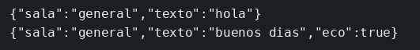

# WebSocket

El concepto está en [WebSockets](../../labs/M03-comunicacion-entre-servicios/04-websockets.md).

## Dónde poner el foco

La conexión queda abierta. Al conectar, el servidor escribe `hola`, y cuando el cliente manda un texto lo devuelve por el mismo canal, sin que haga falta un GET nuevo.

## Archivos

| Archivo | Papel |
|---------|-------|
| `servidor.mjs` | Saluda al conectar y devuelve el texto con `eco` |
| `cliente.mjs` | Envía `buenos dias` al abrirse el canal e imprime lo que llega |
| `package.json` | Scripts `servidor` y `cliente`, dependencia `ws` |

## El código

### `servidor.mjs`

```js
// El canal sigue abierto después del saludo. El servidor escribe al
// conectar, sin un GET nuevo, y vuelve a escribir cuando llega un texto.
// El eco sale por el mismo socket. Mira el puerto 3003 y el campo eco.
import { WebSocketServer } from 'ws';

const wss = new WebSocketServer({ port: 3003 });
console.log('ws en 3003');

wss.on('connection', (socket) => {
  socket.send(JSON.stringify({ sala: 'general', texto: 'hola' }));
  socket.on('message', (datos) => {
    const mensaje = JSON.parse(datos.toString());
    socket.send(JSON.stringify({ sala: 'general', texto: mensaje.texto, eco: true }));
  });
});
```

### `cliente.mjs`

```js
// El texto se envía cuando el canal ya está abierto. Antes de `open`
// el handshake no ha terminado. Las dos líneas que llegan (saludo y eco)
// salen por el mismo manejador message. El proceso se queda en el canal.
import WebSocket from 'ws';

const ws = new WebSocket('ws://127.0.0.1:3003');

ws.on('open', () => {
  ws.send(JSON.stringify({ texto: 'buenos dias' }));
});

ws.on('message', (datos) => {
  console.log(datos.toString());
});
```

## Qué hacer

```bash
cd ejemplos/03-websockets
npm install
npm run servidor
```

En otra terminal, desde la misma carpeta:

```bash
npm run cliente
```

## Qué observar

Salen dos líneas en el cliente. La primera es el saludo que el servidor empuja al conectar, con la sala `general`. La segunda repite `buenos dias` y añade `eco` en true, por el mismo socket. Si paras el cliente antes de que nadie escuche, ese empujón no queda guardado: el canal no es una cola.

## Qué validar

`{"sala":"general","texto":"hola"}` y `{"sala":"general","texto":"buenos dias","eco":true}`.


