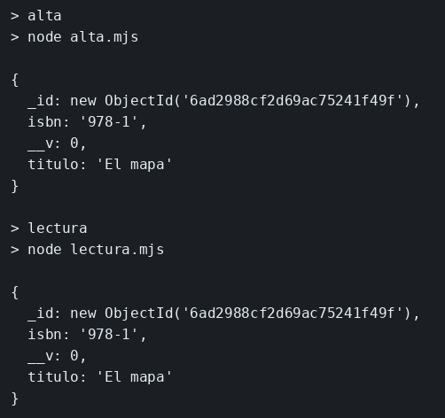

# MongoDB y Mongoose

El concepto está en [MongoDB y Mongoose](../../labs/M04-estado-y-persistencia/00-mongoose.md).

## Dónde poner el foco

El alta escribe el libro y el proceso termina. La lectura es otro proceso: abre la base `libros`, busca el isbn `978-1` y solo pregunta. El documento sigue en MongoDB porque no vivía en la memoria del primer proceso. `unique` en el isbn y el `upsert` dejan un solo documento si el alta se lanza otra vez.

## Archivos

| Archivo | Papel |
|---------|-------|
| `alta.mjs` | Deja el documento con isbn `978-1` y cierra la conexión |
| `lectura.mjs` | Pregunta por ese isbn y lo imprime |
| `docker-compose.yml` | Mongo 7, contenedor `ms-mongo-libros`, puerto `27017` |
| `package.json` | Scripts `alta` y `lectura`; dependencia `mongoose` |

## El código

### `alta.mjs`

```js
// El proceso escribe y termina. El libro no se queda en esta memoria:
// upsert lo deja en MongoDB, y unique impide un segundo documento con
// el mismo isbn si se vuelve a lanzar el alta.
import mongoose from 'mongoose';

await mongoose.connect('mongodb://127.0.0.1:27017/libros');

const Libro = mongoose.model('Libro', new mongoose.Schema({
  isbn: { type: String, required: true, unique: true },
  titulo: String,
}));

const doc = await Libro.findOneAndUpdate(
  { isbn: '978-1' },
  { isbn: '978-1', titulo: 'El mapa' },
  // new: el log muestra lo guardado. Sin ello, el primer insert devolvería null.
  { upsert: true, new: true },
);
console.log(doc.toJSON());
await mongoose.disconnect();
```

### `lectura.mjs`

```js
// Otro proceso, sin el objeto del alta. El esquema no repite unique:
// aquí no se inserta, solo se pregunta por el isbn que el otro dejó.
import mongoose from 'mongoose';

await mongoose.connect('mongodb://127.0.0.1:27017/libros');
const Libro = mongoose.model('Libro', new mongoose.Schema({
  isbn: String,
  titulo: String,
}));
// lean devuelve los campos guardados, sin envolverlos en un documento
console.log(await Libro.findOne({ isbn: '978-1' }).lean());
await mongoose.disconnect();
```

## Qué hacer

```bash
cd ejemplos/04-mongoose
docker compose up -d
until docker exec ms-mongo-libros mongosh --quiet --eval 'db.runCommand({ ping: 1 }).ok'; do sleep 2; done
npm install
npm run alta
npm run lectura
```

## Qué observar

Las dos órdenes imprimen `isbn` `978-1` y `titulo` `El mapa`.

## Qué validar

`lectura` solo pregunta. Repetir `npm run alta` sigue dejando un documento: el isbn es único y el `upsert` actualiza el que ya está.


