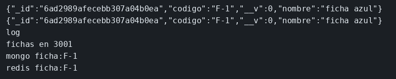

# Redis como caché

El concepto está en [Redis como caché](../../labs/M04-estado-y-persistencia/02-redis.md).

## Dónde poner el foco

El primer GET de `F-1` no encuentra `ficha:F-1` en Redis, lee MongoDB y guarda la clave 60 segundos. El segundo GET lee Redis. Con el contenedor de Mongo parado, la clave sigue respondiendo hasta que expire: la caché es una copia, la ficha sigue teniendo su sitio en Mongo.

## Archivos

| Archivo | Papel |
|---------|-------|
| `semilla.mjs` | Deja la ficha `F-1` en Mongo antes de arrancar el servidor |
| `server.mjs` | GET `/fichas/:codigo`: Redis y, si no hay clave, Mongo |
| `docker-compose.yml` | Mongo 7 (`ms-mongo-fichas`, `27017`) y Redis 7 (`ms-redis-fichas`, `6379`) |
| `package.json` | Scripts `semilla` y `start`; dependencias `express`, `ioredis` y `mongoose` |

## El código

### `semilla.mjs`

```js
// La ficha tiene que existir antes del primer GET. unique en codigo:
// lanzar la semilla otra vez actualiza el mismo documento, no crea otro.
import mongoose from 'mongoose';

await mongoose.connect('mongodb://127.0.0.1:27017/fichas');
const Ficha = mongoose.model('Ficha', new mongoose.Schema({
  codigo: { type: String, unique: true },
  nombre: String,
}));
await Ficha.findOneAndUpdate(
  { codigo: 'F-1' },
  { codigo: 'F-1', nombre: 'ficha azul' },
  { upsert: true },
);
console.log('semilla lista');
await mongoose.disconnect();
```

### `server.mjs`

```js
// Primero Redis, después Mongo. La clave caduca a los 60 s: es una copia
// caliente, no la fuente. Con Mongo parado, el GET sigue saliendo de Redis
// mientras la clave no expire.
import express from 'express';
import mongoose from 'mongoose';
import Redis from 'ioredis';

await mongoose.connect('mongodb://127.0.0.1:27017/fichas');
const Ficha = mongoose.model('Ficha', new mongoose.Schema({ codigo: String, nombre: String }));
const redis = new Redis('redis://127.0.0.1:6379');
const app = express();

app.get('/fichas/:codigo', async (req, res) => {
  const clave = `ficha:${req.params.codigo}`;
  const cacheado = await redis.get(clave);
  if (cacheado) {
    console.log('redis', clave);
    res.json(JSON.parse(cacheado));
    return;
  }
  const doc = await Ficha.findOne({ codigo: req.params.codigo }).lean();
  if (!doc) {
    res.status(404).json({ error: 'ficha no encontrada' });
    return;
  }
  console.log('mongo', clave);
  // EX y no un set eterno: pasado el minuto, el siguiente GET vuelve a Mongo
  await redis.set(clave, JSON.stringify(doc), 'EX', 60);
  res.json(doc);
});

app.listen(3001, () => console.log('fichas en 3001'));
```

## Qué hacer

Si el puerto 27017 lo usa el ejemplo de libros, para ese contenedor antes (`docker rm -f ms-mongo-libros`) o lanza `scripts/limpiar-entorno.sh`.

```bash
cd ejemplos/04-redis-cache
docker compose up -d
until docker exec ms-mongo-fichas mongosh --quiet --eval 'db.runCommand({ ping: 1 }).ok'; do sleep 2; done
npm install
npm run semilla
npm start
```

```bash
curl -s http://127.0.0.1:3001/fichas/F-1; echo
curl -s http://127.0.0.1:3001/fichas/F-1; echo
docker stop ms-mongo-fichas
curl -s http://127.0.0.1:3001/fichas/F-1; echo
```

## Qué observar

En el servidor: `mongo ficha:F-1` y después `redis ficha:F-1`. Los tres curl devuelven la ficha. El tercero, con Mongo parado, va con otra línea `redis`.

## Qué validar

Con `ms-mongo-fichas` parado, la respuesta sigue trayendo `nombre` `ficha azul`. La clave `ficha:F-1` vive 60 segundos; pasada esa caducidad el GET vuelve a necesitar Mongo.


