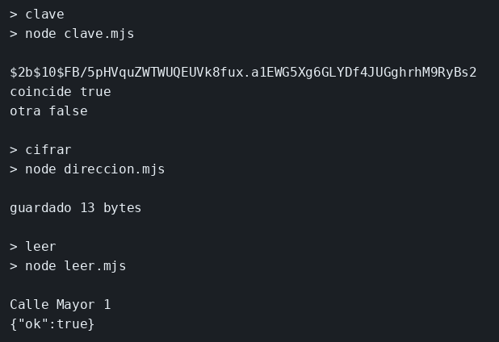

# bcrypt, crypto y TLS

El concepto está en [bcrypt, crypto y TLS](../../labs/M05-seguridad-y-autenticacion/02-cifrado-y-tls.md).

## Dónde poner el foco

Hay tres cifras y cada una cubre una cosa. bcrypt guarda la contraseña para comprobarla, y del hash no se recupera la clave. AES-256-GCM cifra la dirección y sí se recupera, con la misma clave, el IV y la etiqueta que viajan en `direccion.bin`. TLS cifra el canal: el JSON de `/salud` va en claro dentro de la aplicación y cifrado en el cable. El certificado lo firmas tú.

## Archivos

| Archivo | Papel |
|---------|-------|
| `clave.mjs` | Hash bcrypt de `clave-de-eva` y dos `compare` |
| `direccion.mjs` | Cifra `Calle Mayor 1` y escribe `clave.bin` y `direccion.bin` |
| `leer.mjs` | Separa IV, etiqueta y texto, y recupera la calle |
| `server.mjs` | HTTPS en el puerto 3443 con `key.pem` y `cert.pem` |
| `package.json` | Scripts `clave`, `cifrar`, `leer` y `start`; dependencias `bcrypt` y `express` |

## El código

### `clave.mjs`

```js
// El hash no se descifra: compare solo dice si la candidata cuadra.
// El 10 es el coste. Subirlo hace el cálculo más lento a propósito.
import bcrypt from 'bcrypt';

const hash = await bcrypt.hash('clave-de-eva', 10);
console.log(hash);
console.log('coincide', await bcrypt.compare('clave-de-eva', hash));
console.log('otra', await bcrypt.compare('otra', hash));
```

### `direccion.mjs`

```js
// GCM sí se revierte, con la misma clave. El IV es nuevo en cada cifrado
// y viaja delante del fichero: sin él, la clave sola no recupera el texto.
// La etiqueta va en medio para detectar bytes alterados.
import { createCipheriv, randomBytes } from 'node:crypto';
import { writeFileSync } from 'node:fs';

const clave = randomBytes(32);
const iv = randomBytes(12);
const cifrador = createCipheriv('aes-256-gcm', clave, iv);
const cifrado = Buffer.concat([cifrador.update('Calle Mayor 1', 'utf8'), cifrador.final()]);
const tag = cifrador.getAuthTag();
writeFileSync('direccion.bin', Buffer.concat([iv, tag, cifrado]));
writeFileSync('clave.bin', clave);
console.log('guardado', cifrado.length, 'bytes');
```

### `leer.mjs`

```js
// El fichero no es solo el texto cifrado: 12 bytes de IV, 16 de etiqueta
// y el resto el mensaje. Esos cortes tienen que coincidir con el alta.
import { createDecipheriv } from 'node:crypto';
import { readFileSync } from 'node:fs';

const clave = readFileSync('clave.bin');
const datos = readFileSync('direccion.bin');
const desc = createDecipheriv('aes-256-gcm', clave, datos.subarray(0, 12));
desc.setAuthTag(datos.subarray(12, 28));
console.log(Buffer.concat([desc.update(datos.subarray(28)), desc.final()]).toString('utf8'));
```

### `server.mjs`

```js
// TLS cifra el canal entre curl y este proceso. El certificado es de un
// día y está firmado en local: sin -k, curl lo rechaza porque el sistema
// no confía en esa firma.
import https from 'node:https';
import { readFileSync } from 'node:fs';
import express from 'express';

const app = express();
app.get('/salud', (req, res) => {
  res.json({ ok: true });
});

https.createServer({
  key: readFileSync('key.pem'),
  cert: readFileSync('cert.pem'),
}, app).listen(3443, () => console.log('tls en 3443'));
```

## Qué hacer

```bash
cd ejemplos/05-cifrado
npm install
npm run clave
npm run cifrar
npm run leer
openssl req -x509 -newkey rsa:2048 -keyout key.pem -out cert.pem -days 1 -nodes -subj "/CN=localhost"
npm start
```

`key.pem`, `cert.pem`, `clave.bin` y `direccion.bin` son de este ejemplo. No se versionan si los generas en local; no hace falta subirlos.

```bash
curl -sk https://127.0.0.1:3443/salud
echo
```

## Qué observar

Aparece un hash que empieza por `$2`, `coincide true` con la clave buena y `otra false` con una distinta. `leer` recupera `Calle Mayor 1`. Por HTTPS, `/salud` responde `{"ok":true}`.

## Qué validar

`compare` acierta con `clave-de-eva` y falla con `otra`: el hash no es la contraseña al revés. `leer` imprime la calle porque usa la misma clave, el IV y la etiqueta. `curl` sin `-k` rechaza el certificado: lo has firmado tú y el sistema no lo conoce.


