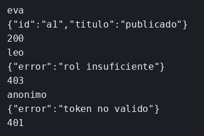

# JWT y roles

El concepto está en [JWT y roles](../../labs/M05-seguridad-y-autenticacion/00-jwt.md).

## Dónde poner el foco

`eva` es editor y puede cambiar el título. `leo` es lector: su token es válido, y aun así el PUT responde 403 porque el rol no alcanza. Sin token, el GET responde 401. Las dos cuentas usan la clave `lab`; lo que cambia es el rol firmado dentro del token. El payload se puede leer sin el secreto; `verify` solo acepta una firma hecha con `secreto-articulos`.

## Archivos

| Archivo | Papel |
|---------|-------|
| `server.mjs` | Emite el token en `/sesion` y protege GET y PUT de `/articulos/a1` |
| `package.json` | Script `start`; dependencias `express` y `jsonwebtoken` |

## El código

### `server.mjs`

```js
// Misma clave `lab`, roles distintos dentro del token. eva (editor) recibe
// 200, leo (lector) 403 con el token válido, y sin cabecera el GET es 401.
// verify exige la firma de secreto-articulos; el payload se podría leer sin ella.
import express from 'express';
import jwt from 'jsonwebtoken';

const SECRETO = 'secreto-articulos';
const cuentas = { eva: 'editor', leo: 'lector' };
let titulo = 'borrador';

const app = express();
app.use(express.json());

app.post('/sesion', (req, res) => {
  const rol = cuentas[req.body.sub];
  // 401 de credenciales: todavía no hay token que comprobar
  if (!rol || req.body.clave !== 'lab') {
    res.status(401).json({ error: 'credenciales' });
    return;
  }
  // El rol va firmado dentro: el PUT no vuelve a mirar `cuentas`
  res.json({ token: jwt.sign({ sub: req.body.sub, rol }, SECRETO, { expiresIn: '15m' }) });
});

function exigir(rolExigido) {
  return (req, res, next) => {
    const cabecera = req.header('authorization') || '';
    const token = cabecera.startsWith('Bearer ') ? cabecera.slice(7) : '';
    try {
      const payload = jwt.verify(token, SECRETO);
      if (rolExigido && payload.rol !== rolExigido) {
        // 403: la firma cuadra y el rol no alcanza. No es un 401.
        res.status(403).json({ error: 'rol insuficiente' });
        return;
      }
      req.usuario = payload;
      next();
    } catch {
      // Firma mala, token vacío o caducado: no se sabe quién llama
      res.status(401).json({ error: 'token no valido' });
    }
  };
}

// Sin rol exigido: cualquier token válido lee. El PUT sí pide editor.
app.get('/articulos/a1', exigir(), (req, res) => {
  res.json({ id: 'a1', titulo, sub: req.usuario.sub });
});

app.put('/articulos/a1', exigir('editor'), (req, res) => {
  titulo = req.body.titulo;
  res.json({ id: 'a1', titulo });
});

app.listen(3001, () => console.log('articulos en 3001'));
```

## Qué hacer

```bash
cd ejemplos/05-jwt
npm install
npm start
```

```bash
TOKEN=$(curl -s -H 'Content-Type: application/json' -d '{"sub":"eva","clave":"lab"}' http://127.0.0.1:3001/sesion | node -e "let s='';process.stdin.on('data',d=>s+=d).on('end',()=>process.stdout.write(JSON.parse(s).token))")
curl -s -w '\n%{http_code}\n' -X PUT -H "Authorization: Bearer $TOKEN" -H 'Content-Type: application/json' -d '{"titulo":"publicado"}' http://127.0.0.1:3001/articulos/a1
TOKEN=$(curl -s -H 'Content-Type: application/json' -d '{"sub":"leo","clave":"lab"}' http://127.0.0.1:3001/sesion | node -e "let s='';process.stdin.on('data',d=>s+=d).on('end',()=>process.stdout.write(JSON.parse(s).token))")
curl -s -w '\n%{http_code}\n' -X PUT -H "Authorization: Bearer $TOKEN" -H 'Content-Type: application/json' -d '{"titulo":"otro"}' http://127.0.0.1:3001/articulos/a1
curl -s -w '\n%{http_code}\n' http://127.0.0.1:3001/articulos/a1
```

## Qué observar

El PUT de `eva` responde 200 y deja el `titulo` en `publicado`. El de `leo` responde 403, con un token válido cuyo rol no alcanza. El GET sin cabecera responde 401, porque no hay identidad.

## Qué validar

El 403 de `leo` llega con un token cuya firma cuadra: el rol no alcanza, la identidad sí. El 401 final es el GET sin cabecera `Authorization`. El payload del token se lee sin la clave (`jwt.decode`). La firma solo cuadra con `secreto-articulos`.


