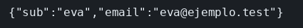

# OAuth 2.0, OpenID Connect y Passport

El concepto está en [OAuth y Passport](../../labs/M05-seguridad-y-autenticacion/01-oauth.md).

## Dónde poner el foco

El portal no pide la contraseña del proveedor. Manda el navegador a `/authorize`, recibe un `code`, lo cambia por un token y con el token pide `/userinfo`. El `sub` es la pieza de identidad de OpenID Connect. El `state` vuelve en la redirección y Passport lo comprueba contra la sesión: por eso `curl` guarda la cookie.

El proveedor de este ejemplo escucha en el puerto 4000. Google, Facebook y GitHub son el mismo intercambio con otras URL:

| Proveedor | Autorización | Token |
|-----------|--------------|-------|
| Este ejemplo | `http://127.0.0.1:4000/authorize` | `http://127.0.0.1:4000/token` |
| GitHub | `https://github.com/login/oauth/authorize` | `https://github.com/login/oauth/access_token` |
| Google | `https://accounts.google.com/o/oauth2/v2/auth` | `https://oauth2.googleapis.com/token` |
| Facebook | `https://www.facebook.com/v19.0/dialog/oauth` | `https://graph.facebook.com/v19.0/oauth/access_token` |

## Archivos

| Archivo | Papel |
|---------|-------|
| `proveedor.mjs` | `/authorize`, `/token` y `/userinfo` en el puerto 4000 |
| `portal.mjs` | Passport, la sesión y `/yo` en el puerto 3002 |
| `package.json` | Scripts `proveedor` y `portal`; dependencias `express`, `express-session`, `passport` y `passport-oauth2` |

## El código

### `proveedor.mjs`

```js
// No hay formulario de login: el code es fijo para poder seguir el
// intercambio con curl. El code vuelve por el navegador; el token sale
// en el POST, y /userinfo solo habla con ese Bearer. El sub es la identidad.
import express from 'express';

const app = express();
app.use(express.urlencoded({ extended: false }));

app.get('/authorize', (req, res) => {
  // El code se añade al redirect_uri del portal: el navegador vuelve allí
  const destino = new URL(req.query.redirect_uri);
  destino.searchParams.set('code', 'codigo-lab');
  // state tiene que volver igual: el portal rechaza el callback si no cuadra
  destino.searchParams.set('state', req.query.state);
  res.redirect(destino.toString());
});

app.post('/token', (req, res) => {
  // El code visto en el navegador no basta: hace falta el secreto del cliente
  if (req.body.code !== 'codigo-lab' || req.body.client_secret !== 'secreto-lab') {
    res.status(400).json({ error: 'invalid_grant' });
    return;
  }
  res.json({ access_token: 'token-eva', token_type: 'Bearer' });
});

app.get('/userinfo', (req, res) => {
  if (req.header('authorization') !== 'Bearer token-eva') {
    res.status(401).end();
    return;
  }
  // OpenID Connect: sub nombra a la persona. El portal no vio la contraseña.
  res.json({ sub: 'eva', email: 'eva@ejemplo.test' });
});

app.listen(4000, () => console.log('proveedor en 4000'));
```

### `portal.mjs`

```js
// El portal no pide la contraseña. Passport lleva el navegador a
// /authorize, cambia el code por un access token y lo guarda en la sesión.
// /yo usa ese token para pedir /userinfo: el sub no viene en /token.
import express from 'express';
import session from 'express-session';
import passport from 'passport';
import { Strategy as OAuth2Strategy } from 'passport-oauth2';

passport.use(new OAuth2Strategy({
  authorizationURL: 'http://127.0.0.1:4000/authorize',
  tokenURL: 'http://127.0.0.1:4000/token',
  clientID: 'portal',
  clientSecret: 'secreto-lab',
  callbackURL: 'http://127.0.0.1:3002/auth/callback',
  state: true, // el state se guarda en la sesión; por eso la sesión va antes
}, (accessToken, refreshToken, profile, done) => {
  // La estrategia no trae el perfil. La identidad se pide luego a /userinfo.
  done(null, { accessToken });
}));

passport.serializeUser((usuario, done) => done(null, usuario));
passport.deserializeUser((usuario, done) => done(null, usuario));

const app = express();
// saveUninitialized en false: la cookie sale cuando Passport escribe el state, no en una visita vacía
app.use(session({ secret: 'sesion-lab', resave: false, saveUninitialized: false }));
app.use(passport.initialize());
app.use(passport.session());

app.get('/auth', passport.authenticate('oauth2'));
app.get('/auth/callback',
  passport.authenticate('oauth2', { failureRedirect: '/fallo' }),
  (req, res) => { res.redirect('/yo'); },
);
app.get('/fallo', (req, res) => {
  res.status(401).json({ error: 'oauth' });
});
app.get('/yo', async (req, res) => {
  if (!req.user) {
    res.status(401).json({ error: 'sin sesion' });
    return;
  }
  // El Bearer es el de la sesión, no el code de la redirección
  const respuesta = await fetch('http://127.0.0.1:4000/userinfo', {
    headers: { authorization: `Bearer ${req.user.accessToken}` },
  });
  res.json(await respuesta.json());
});

app.listen(3002, () => console.log('portal en 3002'));
```

## Qué hacer

```bash
cd ejemplos/05-oauth
npm install
npm run proveedor
```

En otra terminal: `npm run portal`. En una tercera:

```bash
curl -sS -c /tmp/ms-oauth -b /tmp/ms-oauth -L http://127.0.0.1:3002/auth
echo
```

## Qué observar

`/yo` responde `{"sub":"eva","email":"eva@ejemplo.test"}`. Ese `sub` no lo ha escrito el portal: sale de `/userinfo`, llamado con el token que la sesión guardó al volver del proveedor.

## Qué validar

Sin la cookie del tarro, `GET /yo` responde 401: el portal ya no sabe que ese navegador pasó por el callback.


