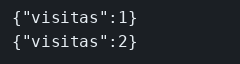

# Docker Compose

El concepto está en [Docker Compose](../../labs/M06-docker-y-kubernetes/01-compose.md).

## Dónde poner el foco

`visitas` no usa `127.0.0.1` para Redis. Usa el nombre del servicio, `redis`, que solo existe en la red que crea Compose. Ese servicio no publica puerto en el host: el `3001` publicado es el de `visitas`. `REDIS_URL` llega por el entorno del compose.

## Archivos

| Archivo | Papel |
|---------|-------|
| `server.mjs` | `GET /visitas` incrementa la clave `visitas` en Redis |
| `Dockerfile` | Imagen del servicio `visitas`: Node 22, usuario `node`, puerto 3001 |
| `docker-compose.yml` | Redis sin puertos publicados y `visitas` con `REDIS_URL` |
| `package.json` | Dependencias `express` e `ioredis` |

## El código

### `server.mjs`

```js
// REDIS_URL nombra al servicio `redis` de Compose, no a una IP. El
// fallback 127.0.0.1 es para un Redis en el host; dentro de la red de
// Compose ese loopback sería el propio contenedor y no vería a Redis.
import express from 'express';
import Redis from 'ioredis';

const redis = new Redis(process.env.REDIS_URL || 'redis://127.0.0.1:6379');
const app = express();

app.get('/visitas', async (req, res) => {
  const n = await redis.incr('visitas');
  res.json({ visitas: n });
});

app.listen(3001, '0.0.0.0', () => console.log('visitas en 3001'));
```

### `docker-compose.yml`

El fichero entero es el bloque que hay que mirar: `redis` no tiene `ports`, y `visitas` recibe el nombre de red en `REDIS_URL`.

```yaml
services:
  redis:
    image: redis:7
    container_name: ms-redis-visitas
  visitas:
    build: .
    container_name: ms-visitas
    ports:
      - "3001:3001"
    environment:
      REDIS_URL: redis://redis:6379
    depends_on:
      - redis
```

## Qué hacer

```bash
cd ejemplos/06-compose
docker compose up --build -d
curl -s http://127.0.0.1:3001/visitas; echo
curl -s http://127.0.0.1:3001/visitas; echo
```

## Qué observar

`visitas` 1 y luego 2.

## Qué validar

Redis no tiene puerto publicado en el host: solo lo ve `visitas`, por el nombre `redis` de la red de Compose. El segundo curl sube el contador porque la clave vive en ese Redis, no en la memoria del proceso.


