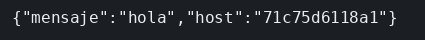

# Dockerfile

El concepto está en [Dockerfile](../../labs/M06-docker-y-kubernetes/00-dockerfile.md).

## Dónde poner el foco

La imagen lleva Node 22 y el servidor. `package.json` se copia antes que `server.mjs` para que `npm install` quede en su propia capa. El proceso corre como usuario `node` y escucha en `0.0.0.0`: en `127.0.0.1` el `-p` del host no entraría. `EXPOSE` documenta el 3001; quien publica el puerto es `docker run -p`. Hasta este punto, los compose de los ejemplos anteriores se usan sin abrir el Dockerfile: aquí se ve qué había dentro.

## Archivos

| Archivo | Papel |
|---------|-------|
| `Dockerfile` | Imagen `node:22-alpine`, install de producción, usuario `node`, `CMD` del servidor |
| `server.mjs` | `GET /hola` en el puerto 3001, en todas las interfaces |
| `package.json` | Dependencia `express`. El proceso lo arranca el `CMD`, no un script `start` |

## El código

### `Dockerfile`

`COPY package.json` va delante del `RUN` para poder reutilizar esa capa cuando solo cambia el servidor. `USER node` es quien ejecuta el `CMD`. `EXPOSE` no publica el puerto.

```dockerfile
FROM node:22-alpine
WORKDIR /app
COPY package.json ./
RUN npm install --omit=dev
COPY server.mjs ./
USER node
EXPOSE 3001
CMD ["node", "server.mjs"]
```

### `server.mjs`

```js
// 0.0.0.0: en 127.0.0.1 el -p del host no entra, porque esa interfaz es
// solo el interior del contenedor. HOSTNAME lo rellena el runtime; fuera
// de Docker cae en `local`.
import express from 'express';

const app = express();
app.get('/hola', (req, res) => {
  res.json({ mensaje: 'hola', host: process.env.HOSTNAME || 'local' });
});
app.listen(3001, '0.0.0.0', () => console.log('hola en 3001'));
```

## Qué hacer

```bash
cd ejemplos/06-dockerfile
docker build -t ms-hola:lab .
docker rm -f ms-hola >/dev/null 2>&1 || true
docker run -d --name ms-hola -p 3001:3001 ms-hola:lab
curl -s http://127.0.0.1:3001/hola
echo
```

## Qué observar

`GET /hola` responde `{"mensaje":"hola","host":"..."}`. El `host` es el del contenedor, no `local`, porque lo rellenó el runtime. `docker exec ms-hola ps` muestra `node server.mjs`, que es el `CMD` de la imagen.

## Qué validar

`host` es el del contenedor, no `local`: lo rellenó el runtime. El puerto publicado responde porque el proceso escucha en `0.0.0.0`, y el proceso que se ve es el `CMD`.


