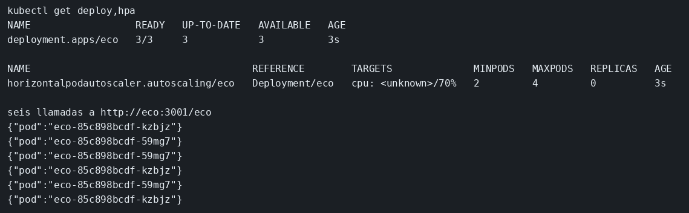

# Helm, réplicas y autoescalado

El concepto está en [Helm y réplicas](../../labs/M06-docker-y-kubernetes/03-helm-y-replicas.md).

## Dónde poner el foco

El chart instala el mismo `eco` del ejemplo de Kubernetes. `replicaCount` sale de `values.yaml`, así que el Deployment nace con 2. El HPA declara un mínimo de 2 y un máximo de 4, pero en kind, sin metrics-server, el objetivo de CPU se queda en `<unknown>` y no mueve réplicas: el objeto existe, y la tercera réplica sale de un `kubectl scale`. Al preguntar el Service `eco` desde dentro del clúster se ven varios Pods, porque el selector `app: eco` es el mismo en el Deployment y en el Service.

Reutiliza la imagen `ms-eco:lab` y el clúster `ms` del ejemplo de Kubernetes. Si no los tienes, los comandos están en [Qué hacer](#qué-hacer).

## Archivos

| Archivo | Papel |
|---------|-------|
| `chart/Chart.yaml` | Chart `eco`, versión `0.1.0` |
| `chart/values.yaml` | `replicaCount: 2` e imagen `ms-eco:lab` |
| `chart/templates/deployment.yaml` | Deployment con las réplicas y la imagen de values |
| `chart/templates/service.yaml` | Service `eco` en el puerto 3001, selector `app: eco` |
| `chart/templates/hpa.yaml` | HPA de 2 a 4 réplicas, objetivo de CPU al 70 % |

## El código

### `chart/values.yaml`

`replicaCount` es el número con el que nace el Deployment. La imagen es la que `kind load` dejó en el clúster.

```yaml
replicaCount: 2
image: ms-eco:lab
```

### `chart/templates/deployment.yaml`

```yaml
apiVersion: apps/v1
kind: Deployment
metadata:
  name: eco
spec:
  replicas: {{ .Values.replicaCount }}
  selector:
    matchLabels:
      app: eco # misma etiqueta que el Service; el nombre del release no selecciona Pods
  template:
    metadata:
      labels:
        app: eco
    spec:
      containers:
        - name: eco
          image: {{ .Values.image }}
          imagePullPolicy: IfNotPresent
          ports:
            - containerPort: 3001
```

### `chart/templates/service.yaml`

```yaml
apiVersion: v1
kind: Service
metadata:
  name: eco
spec:
  selector:
    app: eco # el cliente usa el nombre del Service; esto elige el Pod
  ports:
    - port: 3001
      targetPort: 3001
```

### `chart/templates/hpa.yaml`

```yaml
apiVersion: autoscaling/v2
kind: HorizontalPodAutoscaler
metadata:
  name: eco
spec:
  scaleTargetRef:
    apiVersion: apps/v1
    kind: Deployment
    name: eco
  minReplicas: 2 # declarado aquí; sin metrics-server el objetivo de CPU queda unknown y no mueve réplicas
  maxReplicas: 4
  metrics:
    - type: Resource
      resource:
        name: cpu
        target:
          type: Utilization
          averageUtilization: 70
```

## Qué hacer

Si no tienes la imagen ni el clúster:

```bash
cd ejemplos/06-kubernetes
docker build -t ms-eco:lab .
kind create cluster --name ms
kind load docker-image ms-eco:lab --name ms
```

El ejemplo de Kubernetes deja el Service `eco` creado a mano. Helm no adopta ese objeto: hay que borrarlo antes de instalar el chart. El PVC `eco-datos` no forma parte del chart y puede quedarse.

```bash
cd ejemplos/06-helm
kubectl delete deployment,service eco --ignore-not-found
helm upgrade --install eco chart
kubectl rollout status deployment/eco
kubectl get deploy,hpa
kubectl scale deployment/eco --replicas=3
kubectl rollout status deployment/eco
kubectl run cliente --rm -i --restart=Never --image=curlimages/curl -- \
  sh -c 'for i in 1 2 3 4 5 6; do curl -s http://eco:3001/eco; echo; done'
```

## Qué observar

Tras el install hay dos Pods y el HPA `eco` declara un mínimo de 2. El scale deja tres. En las seis líneas aparecen al menos dos valores distintos de `pod`, porque el Service reparte entre los Pods con `app: eco`.

## Qué validar

El HPA está creado y, sin metrics-server, no mueve réplicas por su cuenta: la tercera sale de `kubectl scale`. Las líneas distintas de `pod` salen porque el Service `eco` reparte entre Pods con `app: eco`.


