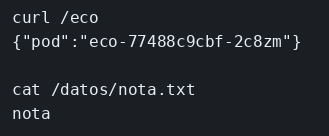

# Kubernetes con kind

El concepto está en [Kubernetes](../../labs/M06-docker-y-kubernetes/02-kubernetes.md).

## Dónde poner el foco

Un Deployment mantiene los Pods de `eco` con la imagen cargada en el clúster. El Service reparte entre ellos porque busca la etiqueta `app: eco`, la misma que lleva cada Pod. El PVC montado en `/datos` conserva el fichero cuando el Pod se borra y el Deployment crea otro: el dato no vivía dentro del Pod. kind no ve las imágenes del host, así que hay que cargar `ms-eco:lab` con `kind load` en el clúster `ms`.

## Archivos

| Archivo | Papel |
|---------|-------|
| `server.mjs` | `GET /eco` devuelve `HOSTNAME`, que en el Pod es el nombre del Pod |
| `Dockerfile` | Imagen `ms-eco:lab` |
| `k8s.yaml` | PVC `eco-datos`, Deployment `eco` y Service `eco` |
| `package.json` | Dependencia `express` |

## El código

### `server.mjs`

```js
// HOSTNAME en el Pod es el nombre del Pod: así se ve a cuál respondió el
// Service. 0.0.0.0 porque el port-forward llega por la red del Pod, no
// por el loopback del proceso.
import express from 'express';

const app = express();
app.get('/eco', (req, res) => {
  res.json({ pod: process.env.HOSTNAME || 'local' });
});
app.listen(3001, '0.0.0.0', () => console.log('eco en 3001'));
```

### `k8s.yaml`

```yaml
apiVersion: v1
kind: PersistentVolumeClaim
metadata:
  name: eco-datos
spec:
  accessModes: ["ReadWriteOnce"]
  resources:
    requests:
      storage: 10Mi
---
apiVersion: apps/v1
kind: Deployment
metadata:
  name: eco
spec:
  replicas: 1
  selector:
    matchLabels:
      app: eco # solo adopta Pods con esta etiqueta; tiene que coincidir con template.labels
  template:
    metadata:
      labels:
        app: eco
    spec:
      containers:
        - name: eco
          image: ms-eco:lab
          imagePullPolicy: IfNotPresent
          ports:
            - containerPort: 3001
          volumeMounts:
            - name: datos
              mountPath: /datos
      volumes:
        - name: datos
          persistentVolumeClaim:
            claimName: eco-datos # el claim sigue vivo cuando el Pod se borra
---
apiVersion: v1
kind: Service
metadata:
  name: eco
spec:
  selector:
    app: eco # mismos Pods que el Deployment: sin esta etiqueta el Service no reparte
  ports:
    - port: 3001
      targetPort: 3001
```

## Qué hacer

```bash
cd ejemplos/06-kubernetes
docker build -t ms-eco:lab .
kind delete cluster --name ms
kind create cluster --name ms
kind load docker-image ms-eco:lab --name ms
kubectl apply -f k8s.yaml
kubectl rollout status deployment/eco
kubectl port-forward svc/eco 3001:3001
```

En otra terminal: `curl -s http://127.0.0.1:3001/eco`. El JSON trae `pod` con el nombre del Pod.

Volumen:

```bash
kubectl exec deploy/eco -- sh -c 'echo nota > /datos/nota.txt'
kubectl delete pod -l app=eco
kubectl rollout status deployment/eco
kubectl exec deploy/eco -- cat /datos/nota.txt
```

## Qué observar

El `cat` imprime `nota`: el fichero sigue en el volumen después de borrar el Pod. El JSON del `curl` trae en `pod` el nombre del Pod que respondió, y ese nombre ya no es el del Pod que escribiste, porque el Deployment creó otro.

## Qué validar

El Pod nuevo tiene otro nombre y el fichero sigue: el PVC `eco-datos` no se borra con el Pod. Si el volumen fuera `emptyDir: {}`, el `cat` no encontraría el fichero.


