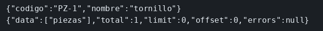

# Jaeger

El concepto está en [Jaeger](../../labs/M07-monitorizacion-y-logging/01-jaeger.md).

## Dónde poner el foco

Una petición concreta, no un contador. El SDK se carga con `--import` antes de Express: el script `start` es `node --import ./instrumentacion.mjs server.mjs`. Si arrancara después, el GET podría no quedar en un trazo. El exportador envía OTLP HTTP al puerto 4318. La UI de Jaeger es el 16686. `OTEL_SERVICE_NAME=piezas` es el nombre que aparece en la lista de servicios. `OTEL_BSP_SCHEDULE_DELAY=500` acorta la espera del lote para que el trazo salga antes del `sleep 1`.

## Archivos

| Archivo | Papel |
|---------|-------|
| `instrumentacion.mjs` | SDK de OpenTelemetry y exportador OTLP hacia `127.0.0.1:4318` |
| `server.mjs` | `GET /piezas/PZ-1`. La ruta no abre el trazo |
| `package.json` | `start` con `--import ./instrumentacion.mjs`; SDK, autoinstrumentación, exportador y `express` |

## El código

### `instrumentacion.mjs`

```js
// --import carga esto antes de Express. Si el SDK arrancara dentro de
// server.mjs, el primer GET podría no quedar instrumentado. El exportador
// habla OTLP HTTP con el 4318 de Jaeger, no con la UI del 16686.
import { NodeSDK } from '@opentelemetry/sdk-node';
import { getNodeAutoInstrumentations } from '@opentelemetry/auto-instrumentations-node';
import { OTLPTraceExporter } from '@opentelemetry/exporter-trace-otlp-http';

const sdk = new NodeSDK({
  traceExporter: new OTLPTraceExporter({ url: 'http://127.0.0.1:4318/v1/traces' }),
  instrumentations: [getNodeAutoInstrumentations()], // el span del GET lo abre la librería, no la ruta
});
sdk.start();
```

### `server.mjs`

```js
// La ruta no crea trazos: los abre la instrumentación cargada antes.
// Cada GET es una petición distinta. Jaeger guarda un trazo por llamada,
// no un contador acumulado.
import express from 'express';

const app = express();
app.get('/piezas/PZ-1', (req, res) => {
  res.json({ codigo: 'PZ-1', nombre: 'tornillo' });
});
app.listen(3001, '0.0.0.0', () => console.log('piezas en 3001'));
```

## Qué hacer

```bash
docker rm -f ms-jaeger >/dev/null 2>&1 || true
docker run -d --name ms-jaeger -e COLLECTOR_OTLP_ENABLED=true -p 16686:16686 -p 4318:4318 jaegertracing/all-in-one:1.62.0
cd ejemplos/07-jaeger
npm install
OTEL_SERVICE_NAME=piezas OTEL_BSP_SCHEDULE_DELAY=500 npm start
```

```bash
curl -s http://127.0.0.1:3001/piezas/PZ-1
echo
sleep 1
curl -s http://127.0.0.1:16686/api/services
echo
```

UI: http://127.0.0.1:16686 servicio `piezas`, Find Traces.

## Qué observar

`/api/services` incluye `piezas`. El trazo nombra el GET `/piezas/PZ-1`. Otro GET crea otro trazo.

## Qué validar

El nombre `piezas` es `OTEL_SERVICE_NAME`, no un texto escrito en la ruta. El JSON del curl es la respuesta HTTP; el trazo viaja aparte, al 4318. La UI solo lo enseña.


