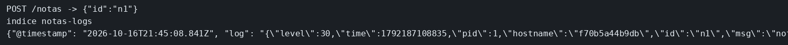

# Logs en Elasticsearch

El concepto está en [Logs](../../labs/M07-monitorizacion-y-logging/02-logs.md).

## Dónde poner el foco

El proceso escribe JSON por stdout con pino y ahí termina su trabajo: no conoce Elasticsearch. Fluent Bit lee el log del contenedor, se queda con las líneas que traen `nota creada` y las entrega al índice `notas-logs`, donde se puede buscar el id `n1`. El temario nombra Fluentd; aquí el recolector es Fluent Bit, el mismo papel en un solo binario. Elasticsearch arranca sin autenticación, suficiente para ver ese documento.

Kibana: http://127.0.0.1:5601

## Archivos

| Archivo | Papel |
|---------|-------|
| `server.mjs` | `POST /notas` escribe `nota creada` con pino y responde `n1` |
| `Dockerfile` | Imagen del servicio `notas` |
| `fluent-bit.conf` | Tail de los logs de Docker, filtro `nota creada`, índice `notas-logs` |
| `docker-compose.yml` | Elasticsearch, Kibana, `notas` y Fluent Bit |
| `package.json` | Dependencias `express` y `pino` |

## El código

### `server.mjs`

```js
// JSON por stdout, y se acaba el trabajo de este proceso. No hay cliente
// de Elasticsearch: Fluent Bit lee el log del contenedor y filtra por
// el texto «nota creada». El id va en el objeto para poder buscar n1.
import express from 'express';
import pino from 'pino';

const log = pino();
const app = express();
app.post('/notas', (req, res) => {
  log.info({ id: 'n1' }, 'nota creada');
  res.status(201).json({ id: 'n1' });
});
app.listen(3001, '0.0.0.0', () => console.log('notas en 3001'));
```

### `fluent-bit.conf`

El filtro existe para no indexar el resto de contenedores. `Host elasticsearch` es el nombre del servicio en la red de Compose. El proceso de notas no aparece en este fichero.

```ini
[SERVICE]
    Flush        1
    Parsers_File /fluent-bit/etc/parsers.conf

[INPUT]
    Name              tail
    Path              /var/lib/docker/containers/*/*.log
    Parser            docker
    Tag               notas.*
    Refresh_Interval  2

[FILTER]
    Name    grep
    Match   *
    Regex   log nota creada

[OUTPUT]
    Name               es
    Match              *
    Host               elasticsearch
    Port               9200
    Index              notas-logs
    Suppress_Type_Name On
```

### `docker-compose.yml`

`notas` publica el 3001 y no tiene variable de Elasticsearch. Fluent Bit es quien monta el directorio de logs del daemon. Elasticsearch y Kibana están en el mismo fichero, con el 9200 y el 5601.

```yaml
  notas:
    build: .
    container_name: ms-notas-log
    ports:
      - "3001:3001"
  fluent-bit:
    image: fluent/fluent-bit:3.2
    container_name: ms-fluent
    volumes:
      - ./fluent-bit.conf:/fluent-bit/etc/fluent-bit.conf:ro
      - /var/lib/docker/containers:/var/lib/docker/containers:ro # lee el json del contenedor; la app no envía a Elasticsearch
    depends_on:
      - elasticsearch
      - notas
```

## Qué hacer

```bash
cd ejemplos/07-logs
docker compose up --build -d
until curl -sf http://127.0.0.1:9200 >/dev/null; do sleep 3; done
curl -s -X POST http://127.0.0.1:3001/notas
echo
until curl -s 'http://127.0.0.1:9200/notas-logs/_search?q=n1' | grep -q n1; do sleep 2; done
curl -s 'http://127.0.0.1:9200/notas-logs/_search?q=n1'
echo
```

En Kibana: Stack Management, Data Views, patrón `notas-logs`, luego Discover.

## Qué observar

El POST devuelve `{"id":"n1"}`. La búsqueda del índice `notas-logs` contiene `nota creada` y ese mismo `n1`, porque Fluent Bit leyó la línea de stdout y la entregó al índice.

## Qué validar

`docker inspect ms-notas-log` no muestra una URL de Elasticsearch. El documento está en `notas-logs` porque Fluent Bit leyó el stdout del contenedor y el filtro dejó pasar esa línea.


