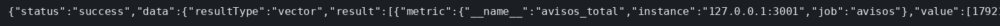

# Prometheus, Grafana y una alerta

El concepto está en [Prometheus y Grafana](../../labs/M07-monitorizacion-y-logging/00-prometheus.md).

## Dónde poner el foco

`/metrics` expone el contador `avisos_total`. Lo incrementa el POST `/avisos`; Prometheus no guarda el aviso, lo rasca cada 5 segundos. Prometheus va en la red del host y rasca `127.0.0.1:3001`, el mismo sitio donde escucha el proceso. Grafana lee a Prometheus. La regla `AvisosSinRaspado` se dispara cuando `up` del job `avisos` lleva 15 segundos en 0.

## Archivos

| Archivo | Papel |
|---------|-------|
| `server.mjs` | Contador `avisos_total`, `GET /metrics` y `POST /avisos` |
| `prometheus.yml` | Raspado cada 5 s del job `avisos` y carga de `alertas.yml` |
| `alertas.yml` | Regla `AvisosSinRaspado` cuando `up{job="avisos"} == 0` |
| `docker-compose.yml` | Prometheus en `9090` y Grafana en `3000` |
| `package.json` | Script `start`; dependencias `express` y `prom-client` |

## El código

### `server.mjs`

```js
// El contador lo incrementa este proceso; Prometheus solo lo rasca en
// /metrics. Prometheus comparte la red del host y llama a 127.0.0.1:3001.
// Si el proceso cae, up pasa a 0 y la regla AvisosSinRaspado puede dispararse.
import express from 'express';
import client from 'prom-client';

const registro = new client.Registry();
client.collectDefaultMetrics({ register: registro });
const altas = new client.Counter({
  name: 'avisos_total',
  help: 'Avisos publicados',
  registers: [registro], // el mismo registro que sirve /metrics; si no, el contador no sale
});

const app = express();
app.get('/metrics', async (req, res) => {
  res.set('Content-Type', registro.contentType);
  res.end(await registro.metrics());
});
app.post('/avisos', (req, res) => {
  altas.inc();
  res.status(201).json({ ok: true });
});
app.listen(3001, '0.0.0.0', () => console.log('avisos en 3001'));
```

### `prometheus.yml`

```yaml
global:
  scrape_interval: 5s
rule_files:
  - /etc/prometheus/alertas.yml
scrape_configs:
  - job_name: avisos
    static_configs:
      - targets: ["127.0.0.1:3001"]
```

### `alertas.yml`

```yaml
groups:
  - name: avisos
    rules:
      - alert: AvisosSinRaspado
        expr: up{job="avisos"} == 0
        for: 15s
        labels:
          gravedad: aviso
        annotations:
          resumen: Prometheus no rasca el proceso de avisos
```

### `docker-compose.yml`

El proceso de avisos no es un servicio del compose: corre en el host. Prometheus usa la red del host y rasca `127.0.0.1:3001`. Grafana entra con el usuario y la clave de abajo, también en la red del host, en el puerto 3000.

```yaml
    network_mode: host
```

```yaml
    environment:
      GF_SECURITY_ADMIN_USER: admin
      GF_SECURITY_ADMIN_PASSWORD: lab-grafana
```

## Qué hacer

```bash
cd ejemplos/07-prometheus
npm install
npm start
```

En otra terminal:

```bash
curl -s -X POST http://127.0.0.1:3001/avisos
docker compose up -d
until curl -sf http://127.0.0.1:9090/-/ready; do sleep 2; done
curl -s 'http://127.0.0.1:9090/api/v1/query?query=avisos_total'
echo
```

Grafana: http://127.0.0.1:3000 usuario `admin`, clave `lab-grafana`. Explore, consulta `avisos_total`.

Para ver la alerta, Ctrl+C en el servidor y:

```bash
until curl -s http://127.0.0.1:9090/api/v1/alerts | grep -q AvisosSinRaspado; do sleep 2; done
```

## Qué observar

La query devuelve el valor `1`. Tras parar el proceso, la API de alertas nombra `AvisosSinRaspado`.

## Qué validar

El `1` sale del POST: Prometheus lo leyó en `/metrics`, no lo incrementó él. Con el proceso parado, `up` del job `avisos` pasa a 0 y, pasados 15 segundos, la alerta está en la API. En Grafana, Explore con `avisos_total` lee esa misma serie.


