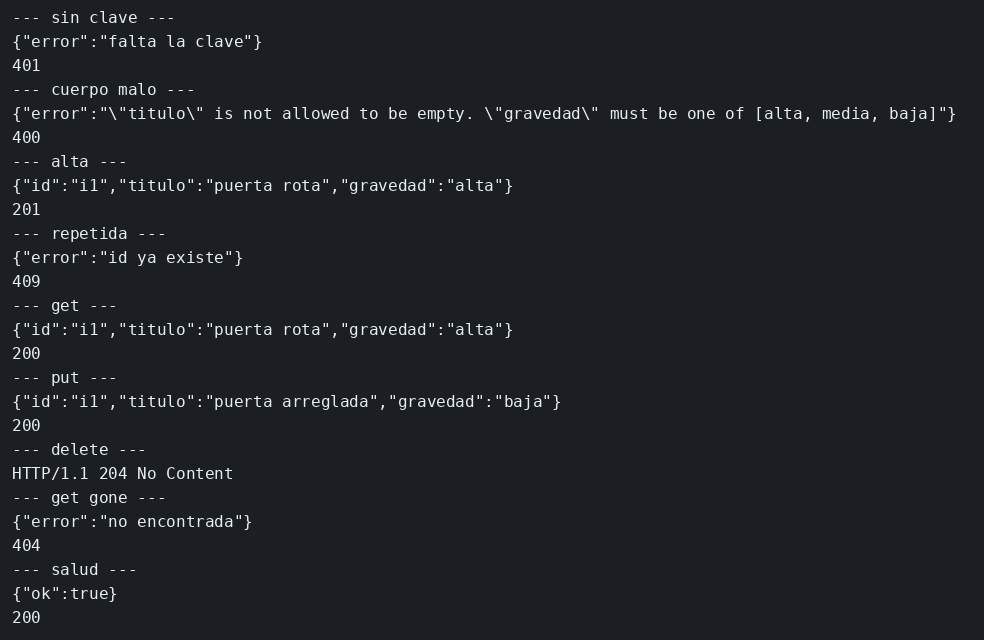

# Laboratorio: la API de incidencias

El ejemplo de rutas guarda notas sin mirar el cuerpo. Aquí el recurso es una incidencia. El servidor de partida solo responde `/salud`, la lista `incidencias` está vacía y el middleware de cuatro argumentos ya sabe convertir un `status` en código HTTP. Vas a sumar el esquema, el alta, el id repetido, la clave y el resto de verbos. Cada trozo se pega y se prueba antes del siguiente. El JSON de cada caso, el contrato al que tienen que llegar, está en [contrato.json](contrato.json).

### Objetivo

Crear, leer, cambiar y borrar la incidencia `i1`, rechazar un cuerpo malo con 400, un id repetido con 409, y un POST sin clave con 401.

### Punto de partida

```bash
bash scripts/limpiar-entorno.sh
cd labs/M02-apis-rest-express/lab-incidencias
npm install
npm start
```

`curl -s http://127.0.0.1:3001/salud` devuelve `{"ok":true}`. Al guardar `server.mjs`, o un fichero que ya importe, el proceso se recarga solo: no hace falta Ctrl+C ni volver a lanzar `npm start`. La lista se vacía. Si el paso depende de una incidencia que acabas de crear, repite los curl de ese paso después del guardado.

Las mismas peticiones están en `peticiones.http`. Ábrelo y pulsa Send Request encima de la que quieras (extensión REST Client).

### 1 — El esquema y un POST que solo valida

**Acción:** crea `validar.mjs` en esta carpeta y pega esto.

```js
import Joi from 'joi';

// Una incidencia trae id, titulo y gravedad. Los tres son obligatorios
// y gravedad solo admite alta, media o baja. El esquema rechaza el cuerpo
// antes de que la ruta lo guarde.
const esquema = Joi.object({
  id: Joi.string().required(),
  titulo: Joi.string().min(1).required(),
  gravedad: Joi.string().valid('alta', 'media', 'baja').required(),
});

export function validar(req, res, next) {
  // abortEarly en false junta todos los fallos en un solo mensaje.
  // convert en false no transforma el cuerpo: una gravedad desconocida
  // sigue siendo desconocida, y un número no aparece donde pedías texto.
  const { error, value } = esquema.validate(req.body, { abortEarly: false, convert: false });
  if (error) {
    // El 400 viaja dentro del error. El middleware de server.mjs lo
    // convierte en la respuesta. Sin esa propiedad saldría un 500.
    next(Object.assign(new Error(error.message), { status: 400 }));
    return;
  }
  req.body = value;
  next();
}
```

Crea `rutas.mjs` con un POST que todavía no mira la clave ni el id repetido.

```js
export function montar(app, validar, incidencias) {
  // validar corre antes que esta función. Si el cuerpo no cuadra,
  // la incidencia no entra en la lista y la respuesta ya salió como 400.
  app.post('/incidencias', validar, (req, res) => {
    incidencias.push(req.body);
    res.status(201).json(req.body);
  });
}
```

En `server.mjs`, el import va con los otros, arriba del todo. `montar` va justo después del GET de `/salud` y antes del middleware de error, para que el 400 lo recoja ese middleware.

```js
// validar juzga el cuerpo. montar cuelga las rutas de esta app y de esta lista.
import { validar } from './validar.mjs';
import { montar } from './rutas.mjs';
```

```js
// La lista es la de este proceso. Las rutas la reciben por aquí.
montar(app, validar, incidencias);
```

Guarda. Cuando vuelva a escuchar, la lista está vacía.

```bash
curl -s -w '\n%{http_code}\n' -H 'Content-Type: application/json' \
  -d '{"id":"i1","titulo":"","gravedad":"urgente"}' http://127.0.0.1:3001/incidencias
curl -s -w '\n%{http_code}\n' -H 'Content-Type: application/json' \
  -d '{"id":"i1","titulo":"puerta rota","gravedad":"alta"}' http://127.0.0.1:3001/incidencias
```

**Por qué:** el cuerpo se juzga antes de entrar en la lista. `urgente` no está entre las gravedades y el título vacío no llega a `min(1)`, así que el primer POST ni se guarda.

**Resultado esperado:** el primer curl termina en 400. El segundo es 201 y el JSON con `puerta rota`. Todavía no hay clave: un POST sin cabecera `x-api-key` entra si el cuerpo cuadra.

### 2 — El id que ya está

**Acción:** en el POST de `rutas.mjs`, sustituye el manejador por este. El `app.post` sigue llevando solo `validar`.

```js
  app.post('/incidencias', validar, (req, res) => {
    // El id identifica la incidencia. Si ya está en la lista no se pisa:
    // se responde 409 y la lista se queda como estaba.
    if (incidencias.some((item) => item.id === req.body.id)) {
      res.status(409).json({ error: 'id ya existe' });
      return;
    }
    incidencias.push(req.body);
    res.status(201).json(req.body);
  });
```

Guarda. La recarga vacía la lista, así que el primer POST crea y el segundo repite.

```bash
curl -s -w '\n%{http_code}\n' -H 'Content-Type: application/json' \
  -d '{"id":"i1","titulo":"puerta rota","gravedad":"alta"}' http://127.0.0.1:3001/incidencias
curl -s -w '\n%{http_code}\n' -H 'Content-Type: application/json' \
  -d '{"id":"i1","titulo":"puerta rota","gravedad":"alta"}' http://127.0.0.1:3001/incidencias
```

**Por qué:** el 409 es de la ruta, no de Joi. El cuerpo del segundo POST es válido y aun así no entra.

**Resultado esperado:** 201 y después 409 con `{"error":"id ya existe"}`.

### 3 — La clave en el POST

**Acción:** al principio de `rutas.mjs`, antes de `montar`, pega la función. En el `app.post`, pon `apiKey` delante de `validar`.

```js
// Escribir exige esta cabecera. Un GET no pasa por aquí.
function apiKey(req, res, next) {
  if (req.header('x-api-key') !== 'lab-incidencias') {
    res.status(401).json({ error: 'falta la clave' });
    return;
  }
  next();
}
```

```js
  // apiKey corre antes que validar: sin la clave, el cuerpo ni se mira.
  app.post('/incidencias', apiKey, validar, (req, res) => {
```

Guarda. La lista queda vacía.

```bash
curl -s -w '\n%{http_code}\n' -H 'Content-Type: application/json' \
  -d '{"id":"i1","titulo":"puerta rota","gravedad":"alta"}' http://127.0.0.1:3001/incidencias
curl -s -w '\n%{http_code}\n' -H 'x-api-key: lab-incidencias' -H 'Content-Type: application/json' \
  -d '{"id":"i1","titulo":"puerta rota","gravedad":"alta"}' http://127.0.0.1:3001/incidencias
```

**Por qué:** `apiKey` corre antes que `validar`. Sin la clave la ruta no mira el cuerpo. La clave de este laboratorio es `lab-incidencias`.

**Resultado esperado:** 401 `{"error":"falta la clave"}` y, con la cabecera, 201.

### 4 — Leer

**Acción:** dentro de `montar`, después del POST, pega el GET.

```js
  // Leer no lleva clave ni cuerpo. Si el id no está, el fallo es 404:
  // no hay recurso, el cliente no mandó un cuerpo mal formado.
  app.get('/incidencias/:id', (req, res) => {
    const item = incidencias.find((incidencia) => incidencia.id === req.params.id);
    if (!item) {
      res.status(404).json({ error: 'no encontrada' });
      return;
    }
    res.json(item);
  });
```

Guarda. El alta hay que repetirla: la recarga deja la lista vacía.

```bash
curl -s -o /dev/null -w '%{http_code}\n' -H 'x-api-key: lab-incidencias' -H 'Content-Type: application/json' \
  -d '{"id":"i1","titulo":"puerta rota","gravedad":"alta"}' http://127.0.0.1:3001/incidencias
curl -s http://127.0.0.1:3001/incidencias/i1; echo
curl -s -w '\n%{http_code}\n' http://127.0.0.1:3001/incidencias/no-esta
```

**Por qué:** el GET no pasa por `apiKey` ni por `validar`. Quien conoce el id puede leerlo.

**Resultado esperado:** 201 en el alta, el JSON de `i1` con `puerta rota`, y 404 en `no-esta`.

### 5 — Cambiar

**Acción:** después del GET, pega el PUT.

```js
  // La misma clave y el mismo esquema que el alta. El id de la URL elige
  // la incidencia; del cuerpo se copian titulo y gravedad.
  app.put('/incidencias/:id', apiKey, validar, (req, res) => {
    const item = incidencias.find((incidencia) => incidencia.id === req.params.id);
    if (!item) {
      res.status(404).json({ error: 'no encontrada' });
      return;
    }
    item.titulo = req.body.titulo;
    item.gravedad = req.body.gravedad;
    res.json(item);
  });
```

Guarda, crea `i1` otra vez y cámbiala. La recarga vacía la lista.

```bash
curl -s -o /dev/null -w '%{http_code}\n' -H 'x-api-key: lab-incidencias' -H 'Content-Type: application/json' \
  -d '{"id":"i1","titulo":"puerta rota","gravedad":"alta"}' http://127.0.0.1:3001/incidencias
curl -s -X PUT -H 'x-api-key: lab-incidencias' -H 'Content-Type: application/json' \
  -d '{"id":"i1","titulo":"puerta arreglada","gravedad":"baja"}' http://127.0.0.1:3001/incidencias/i1
echo
curl -s http://127.0.0.1:3001/incidencias/i1; echo
```

**Por qué:** el cambio es otra escritura. Sin la clave no llega al título, y con un cuerpo que no pasa el esquema tampoco.

**Resultado esperado:** 201, el JSON con `puerta arreglada` y `baja`, y el GET devuelve ese mismo título.

### 6 — Borrar

**Acción:** al final de `montar`, pega el DELETE.

```js
  // Borrar no trae cuerpo, así que no pasa por validar. Sí exige la clave.
  // 204 no lleva JSON: la incidencia ya no está en la lista.
  app.delete('/incidencias/:id', apiKey, (req, res) => {
    const i = incidencias.findIndex((incidencia) => incidencia.id === req.params.id);
    if (i === -1) {
      res.status(404).json({ error: 'no encontrada' });
      return;
    }
    incidencias.splice(i, 1);
    res.status(204).end();
  });
```

Guarda, crea `i1` y bórrala. La recarga vacía la lista.

```bash
curl -s -o /dev/null -w '%{http_code}\n' -H 'x-api-key: lab-incidencias' -H 'Content-Type: application/json' \
  -d '{"id":"i1","titulo":"puerta rota","gravedad":"alta"}' http://127.0.0.1:3001/incidencias
curl -s -D - -o /dev/null -X DELETE -H 'x-api-key: lab-incidencias' http://127.0.0.1:3001/incidencias/i1
curl -s -w '\n%{http_code}\n' http://127.0.0.1:3001/incidencias/i1
curl -s -w '\n%{http_code}\n' http://127.0.0.1:3001/salud
```

**Por qué:** el borrado quita la fila de la lista de este proceso. `/salud` no pasa por `apiKey`, así que sigue respondiendo.

**Resultado esperado:** 201, un 204 sin cuerpo, 404 al volver a leer `i1`, y 200 en `/salud`.

## Si quieres probar

En `validar.mjs`, cambia `min(1)` por `min(20)`. Guarda y repite el POST de `puerta rota` con la clave. Tiene que salir 400: el título es corto para ese esquema. Vuelve a dejar `min(1)` si sigues con el resto.

## Así se ve

Con el servidor recién arrancado, este recorrido junta lo que ya probaste por separado: 401 sin clave, 400 con el cuerpo malo, 201 al crear, 409 al repetir el id, el JSON de `i1`, el título cambiado, 204 al borrar, 404 al volver a leer y 200 en `/salud`.

```bash
curl -s -w '\n%{http_code}\n' -H 'Content-Type: application/json' \
  -d '{"id":"i1","titulo":"","gravedad":"urgente"}' http://127.0.0.1:3001/incidencias
curl -s -w '\n%{http_code}\n' -H 'x-api-key: lab-incidencias' -H 'Content-Type: application/json' \
  -d '{"id":"i1","titulo":"","gravedad":"urgente"}' http://127.0.0.1:3001/incidencias
curl -s -w '\n%{http_code}\n' -H 'x-api-key: lab-incidencias' -H 'Content-Type: application/json' \
  -d '{"id":"i1","titulo":"puerta rota","gravedad":"alta"}' http://127.0.0.1:3001/incidencias
curl -s -w '\n%{http_code}\n' -H 'x-api-key: lab-incidencias' -H 'Content-Type: application/json' \
  -d '{"id":"i1","titulo":"puerta rota","gravedad":"alta"}' http://127.0.0.1:3001/incidencias
curl -s http://127.0.0.1:3001/incidencias/i1; echo
curl -s -X PUT -H 'x-api-key: lab-incidencias' -H 'Content-Type: application/json' \
  -d '{"id":"i1","titulo":"puerta arreglada","gravedad":"baja"}' http://127.0.0.1:3001/incidencias/i1
echo
curl -s -D - -o /dev/null -X DELETE -H 'x-api-key: lab-incidencias' http://127.0.0.1:3001/incidencias/i1
curl -s -w '\n%{http_code}\n' http://127.0.0.1:3001/incidencias/i1
curl -s -w '\n%{http_code}\n' http://127.0.0.1:3001/salud
```



## Comprueba tu entendimiento

**Un GET con id desconocido no es un 400**
`curl -s -w '\n%{http_code}\n' http://127.0.0.1:3001/incidencias/no-esta`
→ 404.

## Reto

### 1 — Gravedad media, lectura sin clave

Da de alta `i2` con título `ventana` y gravedad `media`, con la clave. Léela después sin cabecera `x-api-key`.

<details>
<summary>Ver solución</summary>

```bash
curl -s -w '\n%{http_code}\n' -H 'x-api-key: lab-incidencias' -H 'Content-Type: application/json' \
  -d '{"id":"i2","titulo":"ventana","gravedad":"media"}' http://127.0.0.1:3001/incidencias
curl -s http://127.0.0.1:3001/incidencias/i2; echo
```

201 y el JSON de `i2`. `media` está en el esquema, y el GET no pasa por `apiKey`.

</details>

## Errores frecuentes

| Síntoma | Causa probable | Cómo arreglarlo |
|---------|----------------|-----------------|
| `Cannot find module` | Falta `validar.mjs` o `rutas.mjs`, o el `import` no está arriba | Los dos ficheros al lado de `server.mjs`, y los `import` al principio |
| El 400 llega como 500 | El error no lleva `status`, o `montar` quedó después del middleware de error | `Object.assign(new Error(...), { status: 400 })` y `montar` entre `/salud` y ese middleware |
| La clave también cierra `/salud` | `apiKey` está en un `app.use` global | Solo va delante de POST, PUT y DELETE, dentro de `montar` |
| El 409 no sale y el segundo POST es 201 | Guardaste entre los dos curl y la recarga vació la lista | Lanza los dos POST seguidos, sin guardar en medio |
