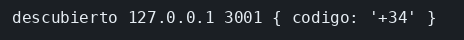

# Laboratorio: descubrir prefijos en Consul

El ejemplo de Consul ya registra `reloj`, y el cliente llama a la dirección que el listín le devuelve. Aquí `prefijos` responde en el 3001 y no se registra, así que `cliente.mjs` tiene el puerto escrito a mano. Primero anuncias el servicio y compruebas que Consul lo ve en passing. Después el cliente lee esa dirección, y solo entonces llama a `/codigo`. La UI de Consul es http://127.0.0.1:8500. El check de salud usa el nombre Docker `prefijos`, y la dirección que ve tu terminal es `127.0.0.1` porque el puerto está publicado en el host.

El registro en Consul y el JSON de `/codigo` están en [contrato.json](contrato.json).

### Objetivo

Ver el servicio `prefijos` en passing y que `cliente.mjs` imprima `descubierto` usando la dirección que devuelve Consul, no la URL fija.

### Punto de partida

```bash
bash scripts/limpiar-entorno.sh
cd labs/M03-comunicacion-entre-servicios/lab-consul
docker compose up --build -d
curl -s http://127.0.0.1:3001/codigo
echo
node cliente.mjs
```

`/codigo` devuelve `{"codigo":"+34"}`. El cliente imprime `directo`. En la UI de Consul no hay servicio `prefijos`.

Las mismas peticiones están en `peticiones.http`. Ábrelo y pulsa Send Request encima de la que quieras (extensión REST Client).

### 1 — Registrarlo al escuchar

**Acción:** crea `prefijos/registro.mjs` con esto.

```js
export async function registrar(consul) {
  // El PUT anuncia el servicio en el agente. Address y Port son los que
  // ve tu terminal, en el host. El check lo hace Consul, que está en la
  // red de Compose: allí el nombre es prefijos, no 127.0.0.1.
  const respuesta = await fetch(`${consul}/v1/agent/service/register`, {
    method: 'PUT',
    headers: { 'content-type': 'application/json' },
    body: JSON.stringify({
      Name: 'prefijos',
      ID: 'prefijos-1',
      Address: '127.0.0.1',
      Port: 3001,
      Check: { HTTP: 'http://prefijos:3001/salud', Interval: '5s' },
    }),
  });
  // Si el agente rechaza el registro, el proceso no sigue en silencio.
  if (!respuesta.ok) throw new Error(`registro ${respuesta.status}`);
  console.log('registrado');
}
```

En `prefijos/server.mjs`, añade el import arriba y sustituye el `listen` por este. El callback pasa a ser `async` para poder usar `await`.

```js
// registrar usa la dirección del agente, la que ya está en `consul`.
import { registrar } from './registro.mjs';
```

```js
// Primero escucha, después se anuncia. Si el PUT fuera antes del listen,
// el check de Consul encontraría el puerto cerrado.
app.listen(3001, '0.0.0.0', async () => {
  console.log('prefijos en 3001');
  await registrar(consul);
});
```

`registro.mjs` entra en la imagen al construir. Reconstruye:

```bash
docker compose up --build -d
docker logs ms-lab-prefijos
```

Espera unos segundos y pregunta el listín:

```bash
curl -s 'http://127.0.0.1:8500/v1/health/service/prefijos?passing'
echo
```

**Por qué:** Consul es el listín. Sin el PUT, el resto de servicios solo pueden usar una dirección que alguien les ha contado. El check usa `prefijos` porque desde el contenedor de Consul ese nombre resuelve; `127.0.0.1` dentro de Consul sería el propio Consul.

**Resultado esperado:** el log dice `registrado`. El curl del health devuelve un JSON con `"Service":"prefijos"` (no `[]`). En http://127.0.0.1:8500 el servicio pasa a passing. El cliente, si lo lanzas ahora, sigue imprimiendo `directo`: todavía no pregunta a Consul.

### 2 — Leer la dirección, sin llamarla todavía

**Acción:** en `cliente.mjs`, deja la línea de `consul` y sustituye el resto del fichero por esto.

```js
const consul = process.env.CONSUL_HTTP_ADDR || 'http://127.0.0.1:8500';

// passing filtra instancias cuyo check responde bien. El cliente ya no
// nombra el 3001: se queda con Address y Port del primer servicio de la lista.
const listaRes = await fetch(`${consul}/v1/health/service/prefijos?passing`);
const lista = await listaRes.json();
if (lista.length === 0) {
  console.error('nadie en passing');
  process.exit(1);
}
const svc = lista[0].Service;
console.log('en passing', svc.Address, svc.Port);
```

```bash
node --watch cliente.mjs
```

El script imprime y el watcher se queda. Al guardar `cliente.mjs`, lo vuelve a ejecutar: no hace falta lanzarlo otra vez. Ctrl+C cierra el watcher. Un cambio en `prefijos/` sigue pidiendo `docker compose up --build -d`: ese código va copiado en la imagen.

**Por qué:** este paso solo comprueba que el listín devuelve una dirección usable desde tu terminal. La llamada a `/codigo` viene después, cuando ya sabes a quién apuntar.

**Resultado esperado:** `en passing 127.0.0.1 3001`. No aparece `directo` ni `+34`.

### 3 — Llamar a quien Consul diga

**Acción:** sustituye el `console.log('en passing'...)` por estas dos líneas.

```js
// Address y Port salieron del listín. Si el servicio se moviera de puerto,
// cambiaría el registro, no esta URL.
const respuesta = await fetch(`http://${svc.Address}:${svc.Port}/codigo`);
console.log('descubierto', svc.Address, svc.Port, await respuesta.json());
```

Guarda `cliente.mjs`. Si cerraste el watcher, `node --watch cliente.mjs`.

**Por qué:** el cliente habla con la dirección que acaba de leer. El 3001 ya no está escrito en este fichero.

**Resultado esperado:** `descubierto 127.0.0.1 3001 { codigo: '+34' }`.

## Así se ve

El cliente usa la dirección que devolvió Consul.



## Comprueba tu entendimiento

**Sin passing no hay a quién llamar**
En `registro.mjs` cambia el check a `http://prefijos:3001/no-esta`, reconstruye (`docker compose up --build -d`) y espera unos segundos. Guarda `cliente.mjs` si el watcher sigue; si no, `node cliente.mjs`.
→ `nadie en passing`. Vuelve a dejar el check en `/salud` para seguir.

## Reto

### 1 — El estado del check

Con el check otra vez en `/salud` y el cliente imprimiendo `descubierto`, imprime también el estado del primer check que vino en la respuesta de Consul.

<details>
<summary>Ver solución</summary>

Justo antes del `console.log('descubierto'...)`:

```js
// Checks viaja en cada entrada del health. El estado del primero dice si /salud respondió.
console.log('check', lista[0].Checks[0].Status);
```

Al guardar, imprime `check passing` y después la línea `descubierto`. `Checks` viaja en cada entrada del health: es el resultado del HTTP que registraste contra `/salud`.

</details>

## Errores frecuentes

| Síntoma | Causa probable | Cómo arreglarlo |
|---------|----------------|-----------------|
| El check está critical | `Address` y el check se han cruzado | El check es `http://prefijos:3001/salud`. La Address del cliente es `127.0.0.1` |
| `ECONNREFUSED` en el cliente | El compose no está, o el registro aún no está en passing | `docker compose ps` y la UI |
| El contenedor no coge tu cambio | Editaste `server.mjs` o `registro.mjs` y no reconstruiste | `docker compose up --build -d` |
| El health responde `[]` | El check todavía no ha pasado, o el PUT no se ejecutó | `docker logs ms-lab-prefijos` tiene que decir `registrado`. Espera el intervalo de 5 s |
