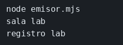

# Laboratorio: el evento no sale del proceso

El ejemplo de EventEmitter ya escucha y emite en el mismo fichero, así que el aviso se ve. Aquí `emisor.mjs` dispara `sensor` y nadie escucha. Tú registras el oyente en ese mismo bus, añades un segundo oyente y compruebas que `oyente.mjs`, que es otro proceso, no se entera. Cada `on` se prueba antes del siguiente. El aviso y lo que tiene que imprimirse están en [contrato.json](contrato.json).

### Objetivo

Ver `sala lab` en el mismo proceso, ver también `registro lab`, y comprobar que `oyente.mjs` no imprime ese aviso.

### Punto de partida

```bash
cd labs/M03-comunicacion-entre-servicios/lab-eventos
node --watch emisor.mjs
```

La ejecución termina sin imprimir `sala lab`. El watcher se queda esperando: al guardar `emisor.mjs`, o un fichero que ya importe, lo vuelve a lanzar. No hace falta repetir el comando. Ctrl+C cierra el watcher.

### 1 — Un oyente en el mismo bus

**Acción:** crea `escucha.mjs` con esto.

```js
// Se registra en el bus que le pasan, el del emisor. Tiene que ocurrir
// antes del emit: si el aviso ya salió, este on no lo recupera.
export function escuchar(bus) {
  bus.on('sensor', (aviso) => {
    console.log('sala', aviso.sala);
  });
}
```

En `emisor.mjs`, añade el import junto al otro, y la llamada antes del `emit`.

```js
// escuchar registra el on en el bus de este fichero, no en el de otro proceso.
import { escuchar } from './escucha.mjs';
```

```js
// Primero el oyente, después el aviso. El objeto es `bus`, el de este fichero.
escuchar(bus);
bus.emit('sensor', { sala: 'lab' });
```

Guarda `emisor.mjs`. El watcher lo vuelve a ejecutar.

**Por qué:** el `bus` de este fichero es el único que recibe el `emit`. El nombre `sensor` solo une funciones registradas en ese objeto.

**Resultado esperado:** `sala lab`.

### 2 — Un segundo oyente, el mismo proceso

**Acción:** dentro de `escuchar`, después del primer `bus.on`, pega este.

```js
  // Segundo oyente del mismo objeto y del mismo nombre. Los dos corren
  // en este proceso, uno detrás de otro, cuando llega `sensor`.
  bus.on('sensor', (aviso) => {
    console.log('registro', aviso.sala);
  });
```

Guarda `escucha.mjs`. El watcher vuelve a ejecutar el emisor.

**Por qué:** en el mismo objeto puedes tener dos funciones. Siguen siendo un solo proceso y un solo `emit`.

**Resultado esperado:** dos líneas, `sala lab` y `registro lab`.

### 3 — El otro proceso

**Acción:** en `oyente.mjs`, antes del `setInterval`, añade esto.

```js
// Este on cuelga del bus de este proceso. El emit del emisor usa otro
// objeto, así que esta función no llega a imprimir `sala lab`.
bus.on('sensor', (aviso) => {
  console.log('sala', aviso.sala);
});
```

Arranca `node --watch oyente.mjs`. En la otra terminal, guarda `emisor.mjs` para lanzarlo otra vez. Si habías cerrado ese watcher, `node --watch emisor.mjs`.

**Por qué:** cada `new EventEmitter()` es un bus distinto. El nombre `sensor` no cruza procesos. Para eso está la cola del laboratorio de RabbitMQ.

**Resultado esperado:** `emisor.mjs` imprime sus dos líneas. `oyente.mjs` no imprime `sala lab`. Páralos con Ctrl+C.

## Si quieres probar

En `emisor.mjs`, mueve `escuchar(bus)` a después del `emit` y guarda. El aviso ya salió antes de que nadie escuchara: silencio, y esa ejecución termina. El watcher sigue esperando. Déjalo otra vez antes del `emit`.

## Así se ve

Al guardar, el emisor imprime las dos líneas. `oyente.mjs`, en la otra terminal, no imprime `sala lab`.



## Comprueba tu entendimiento

**Quitar el enganche**
Comenta `escuchar(bus)`, deja el `emit` y guarda `emisor.mjs`.
→ Silencio. Emitir sin oyente en ese objeto no falla y no llega a ningún sitio.

## Reto

### 1 — Otro nombre de evento

Con `escuchar(bus)` otra vez antes del `emit`, registra dentro de `escuchar` el evento `puerta`: tiene que imprimir `puerta` y `aviso.nombre`. En `emisor.mjs`, después del `emit` de `sensor`, emite `puerta` con `{ nombre: 'principal' }`.

<details>
<summary>Ver solución</summary>

Dentro de `escuchar`:

```js
  // Otro nombre. Este on no se entera del emit de sensor: solo corre con puerta.
  bus.on('puerta', (aviso) => {
    console.log('puerta', aviso.nombre);
  });
```

En `emisor.mjs`, después del emit de `sensor`:

```js
// Mismo bus, otro nombre. Los oyentes de sensor siguen imprimiendo sus líneas.
bus.emit('puerta', { nombre: 'principal' });
```

Al guardar, el emisor imprime `sala lab`, `registro lab` y `puerta principal`. El oyente de `puerta` solo corre cuando el emit usa ese nombre.

</details>

## Errores frecuentes

| Síntoma | Causa probable | Cómo arreglarlo |
|---------|----------------|-----------------|
| `oyente.mjs` imprime el aviso | Estás mirando la terminal del emisor | El oyente es el proceso que no termina solo |
| `Cannot find module` | Falta `escucha.mjs` o no estás en esta carpeta | El fichero al lado de `emisor.mjs` |
| Solo sale `sala lab` | El segundo `bus.on` quedó fuera de `escuchar`, o no guardaste | Los dos `on` van dentro de la función, y guardas para que el watcher lo lance |
