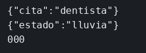

# Laboratorio: un solo puerto

El ejemplo de gateway ya enruta clima y cotizaciones por un solo puerto. Aquí `agenda` y `tiempo` están levantados y no publican el suyo. El gateway escucha en el 8080 y solo responde `/salud`. El fichero `gateway/server.mjs` está montado en el contenedor, así que al guardarlo `node --watch` reinicia y puedes añadir las rutas sin reconstruir la imagen.

### Objetivo

Que `curl` al 8080 devuelva la cita y el tiempo, sin poder llamar a los servicios por su puerto.

### Punto de partida

```bash
bash scripts/limpiar-entorno.sh
cd labs/M03-comunicacion-entre-servicios/lab-gateway
docker compose up --build -d
curl -s http://127.0.0.1:8080/salud
echo
```

`{"ok":true}`. `curl http://127.0.0.1:3001/hoy` no conecta.

### 1 — Crea `gateway/rutas.mjs` y enganchalo

**Acción:** crea `gateway/rutas.mjs` con esto.

```js
async function reenviar(res, url) {
  const respuesta = await fetch(url);
  res.status(respuesta.status).json(await respuesta.json());
}

export function montar(app) {
  app.get('/api/agenda/hoy', async (req, res) => {
    await reenviar(res, 'http://agenda:3001/hoy');
  });

  app.get('/api/tiempo/manana', async (req, res) => {
    await reenviar(res, 'http://tiempo:3002/manana');
  });
}
```

En `gateway/server.mjs`, añade el import arriba y, antes de `listen`, esta línea.

```js
import { montar } from './rutas.mjs';
```

```js
montar(app);
```

Espera a que el log de `ms-lab-gateway` diga otra vez `gateway en 8080`.

```bash
curl -s http://127.0.0.1:8080/api/agenda/hoy
echo
curl -s http://127.0.0.1:8080/api/tiempo/manana
echo
```

**Por qué:** el cliente habla con un puerto. Los nombres `agenda` y `tiempo` solo existen en la red de Compose, que es donde corre el gateway.

**Resultado esperado:** `{"cita":"dentista"}` y `{"estado":"lluvia"}`.

## Si quieres probar

En `rutas.mjs`, cambia el destino de agenda a `http://agenda:3001/ayer` y espera el reinicio. El `curl` a `/api/agenda/hoy` responde 404: el gateway llega a agenda y agenda no tiene esa ruta. Vuelve a dejar `/hoy`.

## Así se ve

Los dos `curl` al 8080. El puerto 3001 del host no responde.



## Comprueba tu entendimiento

**Un prefijo que no has escrito**
`curl -s -w '\n%{http_code}\n' http://127.0.0.1:8080/api/agenda/ayer`
→ 404. El gateway no tiene esa ruta, y `agenda` tampoco tiene `/ayer` si la hubieras reenviado tal cual.

## Errores frecuentes

| Síntoma | Causa probable | Cómo arreglarlo |
|---------|----------------|-----------------|
| `fetch failed` en el log del gateway | El destino usa `127.0.0.1` | Desde el gateway los nombres son `agenda` y `tiempo` |
| El curl sigue en 404 después de guardar | `--watch` aún no ha reiniciado | `docker logs --tail 5 ms-lab-gateway` tiene que repetir `gateway en 8080` |
| Cambiaste `agenda/server.mjs` y no se ve | Ese fichero no está montado | `docker compose up --build -d` |
