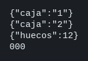

# Laboratorio: un puerto y dos cajas

`caja-1`, `caja-2` y `almacen` ya responden y no publican su puerto. HAProxy escucha en el 8080. `/salud` lo contesta el propio proxy. Cualquier camino `/api/...` responde 503 porque `haproxy.cfg` todavía no tiene backends. Primero enrutas el almacén, lo pruebas, y después repartes las dos cajas por el mismo camino. Al parar una caja, el check la saca del reparto. El fichero está montado en el contenedor: al guardarlo, `docker kill --signal USR2 ms-lab-haproxy` lo vuelve a leer. No hace falta reconstruir la imagen.

Los caminos públicos, el origen dentro de Compose y el JSON de cada servicio están en [contrato.json](contrato.json).

### Objetivo

Que `curl` al 8080 devuelva los huecos del almacén y alterne las cajas 1 y 2, y que al parar una caja las peticiones se queden en la otra.

### Punto de partida

```bash
bash scripts/limpiar-entorno.sh
bash scripts/red-docker-codespace.sh
cd labs/M03-comunicacion-entre-servicios/lab-haproxy
docker compose up --build -d
curl -s http://127.0.0.1:8080/salud
echo
curl -s -o /dev/null -w '%{http_code}\n' http://127.0.0.1:8080/api/caja/abierta
curl -s -o /dev/null -w '%{http_code}\n' --connect-timeout 2 http://127.0.0.1:3001/abierta
```

El cuerpo de `/salud` contiene `Service ready.` El camino de la caja responde `503`. El `curl` al 3001 imprime `000`: ese puerto no está publicado.

`red-docker-codespace.sh` es para el Codespace: sin él, HAProxy no alcanza a `caja-1` ni a `almacen` dentro de Compose y el check se queda en DOWN. Fuera de un Codespace no hace nada. La explicación está en [Entorno](../../../infra/README.md#codespace-contenedores-que-no-se-ven).

Las mismas peticiones están en `peticiones.http`. Ábrelo y pulsa Send Request encima de la que quieras (extensión REST Client).

### 1 — El almacén, un solo servidor

**Acción:** dentro de `frontend entrada`, después del comentario de las ACL, pega estas dos líneas. La sangría es de cuatro espacios, igual que `bind`.

```
    acl es_almacen path_beg /api/almacen
    use_backend almacen if es_almacen
```

Al final del fichero, en la columna 0, pega el backend.

```
backend almacen
    option httpchk
    http-check send meth GET uri /salud
    # La ACL ya eligió este backend con el prefijo puesto.
    # Esta línea se lo quita: /api/almacen/huecos llega a almacen como /huecos.
    http-request set-path %[path,regsub(^/api/almacen/,/)]
    server almacen almacen:3002 check inter 1s fall 2 rise 1
```

Comprueba el fichero y dile al proceso que lo relea. `valido` sale solo si la configuración cierra bien. El log tiene que repetir `Loading success.`

```bash
docker exec ms-lab-haproxy haproxy -c -f /usr/local/etc/haproxy/haproxy.cfg && echo valido
docker kill --signal USR2 ms-lab-haproxy
docker logs --tail 5 ms-lab-haproxy
curl -s http://127.0.0.1:8080/api/almacen/huecos
echo
curl -s -o /dev/null -w '%{http_code}\n' http://127.0.0.1:8080/api/caja/abierta
```

**Por qué:** el cliente habla con el 8080. El nombre `almacen` solo existe en la red de Compose. El servicio no tiene una ruta `/api/almacen/huecos`: tiene `/huecos`. La caja sigue en 503 porque todavía no hay ACL para ella.

**Resultado esperado:** `{"huecos":12}` y, en la línea siguiente, `503`. Si el primer curl es 503, el check aún no ha marcado el servidor: espera dos segundos y repite. `docker logs --tail 5 ms-lab-haproxy` no debe decir `no server available` para `almacen`.

### 2 — Las dos cajas, el mismo camino

**Acción:** en el frontend, debajo de las líneas del almacén, pega estas dos.

```
    acl es_caja path_beg /api/caja
    use_backend caja if es_caja
```

Al final del fichero, otro backend. `uno` y `dos` son los nombres que verás en las stats. `caja-1` y `caja-2` son los nombres de Compose.

```
backend caja
    balance roundrobin
    option httpchk
    http-check send meth GET uri /salud
    http-request set-path %[path,regsub(^/api/caja/,/)]
    server uno caja-1:3001 check inter 1s fall 2 rise 1
    server dos caja-2:3001 check inter 1s fall 2 rise 1
```

```bash
docker exec ms-lab-haproxy haproxy -c -f /usr/local/etc/haproxy/haproxy.cfg && echo valido
docker kill --signal USR2 ms-lab-haproxy
curl -s http://127.0.0.1:8080/api/caja/abierta
echo
curl -s http://127.0.0.1:8080/api/caja/abierta
echo
curl -s http://127.0.0.1:8080/api/almacen/huecos
echo
```

**Por qué:** las dos cajas escuchan el 3001, cada una en su contenedor. Desde HAProxy son dos direcciones distintas. `roundrobin` entrega una conexión nueva a cada una. El almacén no cambia de servidor: su backend solo tiene una línea `server`.

**Resultado esperado:** `{"caja":"1"}`, después `{"caja":"2"}`, y otra vez `{"huecos":12}`. El 3001 del host sigue cerrado.

### 3 — Una caja parada

**Acción:** para la segunda caja y espera a que el check la marque.

```bash
docker stop ms-lab-caja-2
sleep 6
curl -s 'http://127.0.0.1:8080/stats;csv' | grep '^caja,'
echo
curl -s http://127.0.0.1:8080/api/caja/abierta
echo
curl -s http://127.0.0.1:8080/api/caja/abierta
echo
```

Vuelve a dejarla en marcha para los pasos de después:

```bash
docker start ms-lab-caja-2
sleep 3
```

**Por qué:** el cliente no tiene otra URL. HAProxy deja de elegir al servidor cuyo `/salud` no responde. `fall 2` e `inter 1s` tardan unos segundos: si el CSV dice `UP 1/2`, el check todavía no ha cerrado y hay que esperar a `DOWN`. `option redispatch` manda a la otra caja la petición que pilla al proceso ya parado. La página http://127.0.0.1:8080/stats enseña lo mismo que el CSV.

**Resultado esperado:** en el CSV, `caja,uno` está `UP` y `caja,dos` está `DOWN`. Los dos `curl` devuelven `{"caja":"1"}`. Tras el `docker start`, `caja,dos` vuelve a `UP`.

## Si quieres probar

En el backend `almacen`, cambia la línea `set-path` por `http-request set-path /no-esta`, recarga con el mismo `-c` y `USR2`, y pide otra vez `/api/almacen/huecos`. Responde `{"error":"no esta"}` con 404: HAProxy llegó a almacen y almacen no tiene esa ruta. Vuelve a dejar el `regsub(^/api/almacen/,/)`.

## Así se ve

Los dos `curl` de la caja, el del almacén, y el 3001 del host sin respuesta.



## Comprueba tu entendimiento

**Un camino que el servicio no tiene**
`curl -s -w '\n%{http_code}\n' http://127.0.0.1:8080/api/caja/cerrada`
→ `{"error":"no esta"}` y `404`. La ACL sí eligió el backend `caja`. La caja no tiene `/cerrada`.

**Un prefijo que no has escrito**
`curl -s -o /dev/null -w '%{http_code}\n' http://127.0.0.1:8080/api/otra`
→ `503`. Ninguna ACL coincide, y HAProxy no tiene a quién enviar la petición.

## Reto

### 1 — Una cabecera que pone el proxy

Haz que la respuesta de `/api/almacen/huecos` traiga la cabecera `X-Entrada: haproxy`. El almacén no la envía. La añade el frontend.

<details>
<summary>Ver solución</summary>

Dentro de `frontend entrada`, debajo de `bind *:8080`:

```
    http-response set-header X-Entrada haproxy
```

```bash
docker exec ms-lab-haproxy haproxy -c -f /usr/local/etc/haproxy/haproxy.cfg && echo valido
docker kill --signal USR2 ms-lab-haproxy
```

Cuando el log repita `Loading success.`:

```bash
curl -s -D - -o /dev/null http://127.0.0.1:8080/api/almacen/huecos
```

La respuesta incluye `x-entrada: haproxy`. El JSON de los huecos no cambia: la cabecera la ha puesto HAProxy al salir.

</details>

## Errores frecuentes

| Síntoma | Causa probable | Cómo arreglarlo |
|---------|----------------|-----------------|
| `valido` no sale y el log nombra una línea | El fichero no cierra: `backend` con espacios delante, o una ACL fuera del frontend | `backend` en la columna 0. Las ACL, debajo de `bind`, con cuatro espacios. No lances `USR2` hasta ver `valido` |
| 503 en `/api/almacen/huecos` después de `Loading success.` | El check todavía no ha pasado, o el `server` apunta a `127.0.0.1` | Los nombres son `almacen`, `caja-1` y `caja-2`. Espera dos segundos. En el CSV ese servidor tiene que estar `UP` |
| 404 `{"error":"no esta"}` en un camino que sí existe | `set-path` no quitó el prefijo y el servicio recibió `/api/almacen/huecos` | El `regsub` es `^/api/almacen/` y está en el backend, después del `use_backend` |
| Las dos peticiones devuelven la misma caja | Solo hay una línea `server`, o la otra está `DOWN` | El CSV de `caja` tiene `uno` y `dos` en `UP` |
| `Connection refused` en el log, con el `server` bien escrito | En el Codespace, los contenedores de Compose no se ven entre sí | `bash scripts/red-docker-codespace.sh` desde la raíz y `docker compose up -d` |
| Cambiaste `caja/server.mjs` y no se ve | Ese fichero va copiado en la imagen | `docker compose up --build -d` |
