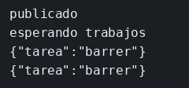

# Laboratorio: la cola guarda el trabajo

El ejemplo de RabbitMQ ya publica en `avisos` y el consumidor ya sabe ese nombre. Aquí la cola se llama `trabajos` y el mensaje es `{"tarea":"barrer"}`, pero los dos programas todavía no se han puesto de acuerdo. Tú dejas el nombre y el cuerpo en un solo sitio y compruebas que el mensaje espera si nadie escucha. Kafka está en `ejemplos/03-kafka` para ver el otro broker. Este laboratorio es solo RabbitMQ.

### Objetivo

Ver `{"tarea":"barrer"}` en el consumidor, y ver `Ready` 1 en la consola si publicas con el consumidor parado.

### Punto de partida

```bash
bash scripts/limpiar-entorno.sh
cd labs/M03-comunicacion-entre-servicios/lab-rabbitmq
docker compose up -d
until docker exec ms-lab-rabbit rabbitmq-diagnostics -q ping; do sleep 2; done
npm install
```

Consola: http://127.0.0.1:15672 usuario `guest`, clave `guest`.

### 1 — Crea `mensaje.mjs` y úsalo en los dos programas

**Acción:** crea `mensaje.mjs` con esto.

```js
export const cola = 'trabajos';
export const cuerpo = JSON.stringify({ tarea: 'barrer' });
```

En `publicador.mjs` y en `consumidor.mjs`, añade el import junto al de `amqplib`.

```js
import { cola, cuerpo } from './mensaje.mjs';
```

En `consumidor.mjs`, borra la línea `const cola = 'PON_AQUI_LA_COLA';`.

En `publicador.mjs`, borra `const cola = 'PON_AQUI_LA_COLA';` y sustituye el `JSON.stringify({ tarea: 'PON_AQUI_LA_TAREA' })` por `cuerpo`.

**Por qué:** si cada fichero afirma una cola distinta, el mensaje se publica donde nadie lee. El nombre vive en un solo sitio.

**Resultado esperado:** los dos programas usan `trabajos`. El JSON publicado es `{"tarea":"barrer"}`.

### 2 — Publica con el consumidor parado

**Acción:**

```bash
npm run publicar
```

Abre Queues → `trabajos` en la consola.

**Por qué:** la cola es el sitio donde el aviso sobrevive al proceso que lo va a tratar.

**Resultado esperado:** `publicado` en la terminal. En la consola, `Ready` es 1.

### 3 — Arranca el consumidor

**Acción:**

```bash
npm run consumir
```

**Por qué:** al reconocer el mensaje (`ack`), RabbitMQ lo quita de Ready.

**Resultado esperado:** la terminal imprime `{"tarea":"barrer"}`. En la consola, `Ready` vuelve a 0.

### 4 — Publica con el consumidor en marcha

**Acción:** en otra terminal, desde esta carpeta, `npm run publicar`.

**Por qué:** con alguien escuchando, el aviso no se queda en Ready: pasa al proceso.

**Resultado esperado:** otra línea `{"tarea":"barrer"}` en el consumidor. `Ready` sigue en 0.

## Así se ve

El publicador dice `publicado`. El consumidor imprime `{"tarea":"barrer"}` una vez por cada publicación.



## Comprueba tu entendimiento

**Otra cola no recibe el mensaje**
Cambia solo el publicador a la cola `otras` y publica, con el consumidor todavía en `trabajos`.
→ El consumidor no imprime. En la consola aparece la cola `otras` con Ready 1. Vuelve a dejar `trabajos` en los dos.

## Errores frecuentes

| Síntoma | Causa probable | Cómo arreglarlo |
|---------|----------------|-----------------|
| `ECONNREFUSED` | El `until` no terminó | Espera el ping y repite |
| Ready no baja | El consumidor está en otra cola, o no hace `ack` | Misma cadena `trabajos` y `ch.ack(msg)` |
