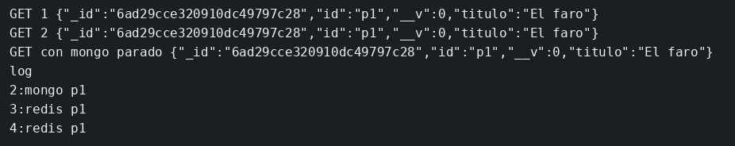

# Laboratorio: la segunda lectura no toca Mongo

El ejemplo de caché ya distingue una lectura que sale de Mongo de otra que sale de Redis. Aquí cada GET de `p1` escribe `mongo` en el log, aunque Redis esté levantado y el cliente creado. El trabajo es hacer que la segunda lectura salga de la copia.

### Objetivo

El primer GET loguea `mongo`. El segundo loguea `redis`. Con Mongo parado, el GET sigue devolviendo `El faro`.

### Punto de partida

```bash
bash scripts/limpiar-entorno.sh
cd labs/M04-estado-y-persistencia/lab-cache
docker compose up -d
until docker exec ms-lab-mongo mongosh --quiet --eval 'db.runCommand({ ping: 1 }).ok'; do sleep 2; done
npm install
npm run semilla
npm start
```

```bash
curl -s http://127.0.0.1:3001/peliculas/p1; echo
curl -s http://127.0.0.1:3001/peliculas/p1; echo
```

Las dos respuestas son `El faro`. El log dice `mongo p1` dos veces.

### 1 — Crea `lectura.mjs` y úsala en el GET

**Acción:** crea `lectura.mjs` con esto.

```js
export async function leer(Pelicula, redis, id) {
  const clave = `pelicula:${id}`;
  const cacheado = await redis.get(clave);
  if (cacheado) {
    console.log('redis', id);
    return JSON.parse(cacheado);
  }
  const doc = await Pelicula.findOne({ id }).lean();
  if (!doc) return null;
  console.log('mongo', id);
  await redis.set(clave, JSON.stringify(doc), 'EX', 60);
  return doc;
}
```

En `server.mjs`, añade el import arriba y sustituye el cuerpo del GET por esto.

```js
import { leer } from './lectura.mjs';
```

```js
app.get('/peliculas/:id', async (req, res) => {
  const doc = await leer(Pelicula, redis, req.params.id);
  if (!doc) {
    res.status(404).json({ error: 'no encontrada' });
    return;
  }
  res.json(doc);
});
```

Reinicia. Borra la clave por si quedó a medias: `docker exec ms-lab-redis redis-cli del pelicula:p1`. Dos `curl`.

**Por qué:** la primera vez la clave no existe y se lee Mongo. La segunda, Redis responde y Mongo no se toca. Los 60 segundos evitan servir un título viejo para siempre.

**Resultado esperado:** log `mongo p1` y después `redis p1`. Los dos cuerpos traen `El faro`.

### 3 — Para Mongo

**Acción:**

```bash
docker stop ms-lab-mongo
curl -s http://127.0.0.1:3001/peliculas/p1; echo
```

**Por qué:** la respuesta sale de Redis. Si la clave no está y Mongo está parado, el GET ya no puede rellenar la caché.

**Resultado esperado:** el JSON de `p1` y una línea `redis` en el servidor.

## Así se ve

Los tres GET traen `El faro`. El log pasa de `mongo` a `redis`, y el tercero sigue en `redis` con Mongo parado.



## Comprueba tu entendimiento

**La clave caduca**
`docker exec ms-lab-redis redis-cli ttl pelicula:p1`
→ Un entero entre 1 y 60.

## Errores frecuentes

| Síntoma | Causa probable | Cómo arreglarlo |
|---------|----------------|-----------------|
| Los dos GET dicen `mongo` | No guardas la clave, o no reiniciaste | El `set` está antes del `res.json` y el proceso es el nuevo |
| 500 con Mongo parado | La clave no existía | Repite los dos GET del paso 2 antes de `docker stop` |
