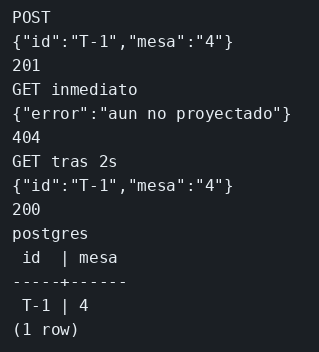

# Laboratorio: el GET no lee la tabla

El ejemplo de CQRS ya separa la escritura de la lectura. Aquí el POST guarda el turno en PostgreSQL y el GET lee esa misma tabla, por eso el GET inmediato ya ve `T-1`. Redis está conectado y no se usa. Primero programas la copia y compruebas que el GET sigue leyendo la tabla. Después cambias el GET para que lea Redis, y durante un segundo y medio esa copia todavía no está.

El JSON del turno, el 404 del hueco y la copia en Redis están en [contrato.json](contrato.json).

### Objetivo

201 en el POST, 404 `aun no proyectado` en el GET inmediato, y 200 con `mesa` `4` cuando haya pasado el segundo y medio. La fila sigue en PostgreSQL durante el 404.

### Punto de partida

```bash
bash scripts/limpiar-entorno.sh
cd labs/M04-estado-y-persistencia/lab-cqrs
docker compose up -d
until docker exec ms-lab-pg pg_isready -U postgres; do sleep 2; done
npm install
npm start
```

```bash
curl -s -w '\n%{http_code}\n' -X POST http://127.0.0.1:3002/turnos
curl -s -w '\n%{http_code}\n' http://127.0.0.1:3002/turnos/T-1
```

201 y, enseguida, 200. Los dos ven la mesa.

Al guardar `server.mjs`, o un fichero que ya importe, el proceso se recarga solo. No hace falta Ctrl+C ni volver a lanzar `npm start`. La fila sigue en PostgreSQL y la clave en Redis. Un retardo que aún no haya escrito la copia se pierde: repite el POST de ese paso.

Las mismas peticiones están en `peticiones.http`. Ábrelo y pulsa Send Request encima de la que quieras (extensión REST Client).

### 1 — Programar la copia, el GET sigue en la tabla

**Acción:** crea `proyeccion.mjs` solo con el retardo. Todavía no hay consulta.

```js
export function programar(redis, turno) {
  // La fila ya está en PostgreSQL. La copia en Redis espera 1,5 s.
  // La línea del terminal marca el momento en que esa copia llega.
  setTimeout(async () => {
    await redis.set(`turno:${turno.id}`, JSON.stringify(turno));
    console.log('proyectado', turno.id);
  }, 1500);
}
```

En `server.mjs`, añade el import arriba. Dentro del POST, después del `upsert` y antes del `res.status(201)`, añade la llamada. El GET no se toca.

```js
// programar solo encarga la copia. El GET de este fichero sigue en la tabla.
import { programar } from './proyeccion.mjs';
```

```js
  // Después del upsert la fila ya está. La copia en Redis sale 1,5 s más tarde.
  programar(redis, turno);
```

Guarda. Borra una copia vieja si la hubiera: la recarga no vacía Redis.

```bash
docker exec ms-lab-redis redis-cli del turno:T-1
curl -s -w '\n%{http_code}\n' -X POST http://127.0.0.1:3002/turnos
curl -s -w '\n%{http_code}\n' http://127.0.0.1:3002/turnos/T-1
sleep 2
docker exec ms-lab-redis redis-cli get turno:T-1
echo
```

**Por qué:** el comando ya dejó encargada la copia, y la consulta de esta ruta sigue siendo la tabla. Por eso el GET inmediato ve la mesa aunque Redis aún no tenga la clave. Un segundo y medio después el servidor imprime `proyectado T-1`.

**Resultado esperado:** 201, 200 con `mesa` `4`, y después del `sleep` el `get` imprime el JSON del turno. En la terminal del servidor, `proyectado T-1` sale después del POST, no a la vez.

### 2 — La consulta lee la copia

**Acción:** al final de `proyeccion.mjs`, pega la consulta.

```js
export async function consultar(redis, id) {
  // Esta lectura ya no mira la tabla. Si la copia no ha llegado, para
  // esta ruta no hay turno, aunque PostgreSQL sí lo tenga.
  const crudo = await redis.get(`turno:${id}`);
  if (!crudo) return null;
  return JSON.parse(crudo);
}
```

Sustituye el import y el cuerpo del GET.

```js
// consultar es la lectura. programar sigue siendo la que deja la copia en Redis.
import { programar, consultar } from './proyeccion.mjs';
```

```js
// Esta ruta ya no abre la tabla. Si la copia no ha llegado, responde 404.
app.get('/turnos/:id', async (req, res) => {
  const turno = await consultar(redis, req.params.id);
  if (!turno) {
    res.status(404).json({ error: 'aun no proyectado' });
    return;
  }
  res.json(turno);
});
```

Guarda. Redis conserva `turno:T-1`: bórrala o el GET inmediato ya será 200.

```bash
docker exec ms-lab-redis redis-cli del turno:T-1
curl -s -w '\n%{http_code}\n' -X POST http://127.0.0.1:3002/turnos
curl -s -w '\n%{http_code}\n' http://127.0.0.1:3002/turnos/T-1
sleep 2
curl -s -w '\n%{http_code}\n' http://127.0.0.1:3002/turnos/T-1
docker exec ms-lab-pg psql -U postgres -d turnos -c 'select id, mesa from turnos;'
```

**Por qué:** comando y consulta no pasan por el mismo sitio. El hueco entre los dos es la consistencia eventual. El `select` enseña que el 404 no borró el turno.

**Resultado esperado:** 201, 404 `aun no proyectado`, 200 con `mesa` `4`. El `select` muestra `T-1`.

## Así se ve

201, 404 `aun no proyectado`, 200 con `mesa` `4`. El `select` muestra la fila durante el 404.



## Comprueba tu entendimiento

**Borrar la proyección no borra la fila**
`docker exec ms-lab-redis redis-cli del turno:T-1` y otro GET.
→ 404. El `select` sigue mostrando la fila.

## Reto

### 1 — Un hueco más largo

Deja el retardo en 4 segundos. Comprueba el GET a los 2 segundos del POST y otra vez cuando ya hayan pasado los 4.

<details>
<summary>Ver solución</summary>

En `programar`, cambia `1500` por `4000`. Guarda.

```bash
docker exec ms-lab-redis redis-cli del turno:T-1
curl -s -o /dev/null -w '%{http_code}\n' -X POST http://127.0.0.1:3002/turnos
sleep 2
curl -s -w '\n%{http_code}\n' http://127.0.0.1:3002/turnos/T-1
sleep 3
curl -s -w '\n%{http_code}\n' http://127.0.0.1:3002/turnos/T-1
```

A los 2 segundos, 404 `aun no proyectado`. Después, 200 con `mesa` `4`. Vuelve a dejar `1500` si sigues con el resto del laboratorio.

</details>

## Errores frecuentes

| Síntoma | Causa probable | Cómo arreglarlo |
|---------|----------------|-----------------|
| El GET inmediato ya es 200 | Quedó `turno:T-1` de un intento anterior | `redis-cli del turno:T-1` y repite el POST |
| Sigue en 404 después de dos segundos | El `setTimeout` no está en el POST que estás ejecutando | Guarda y espera la recarga |
| El GET del paso 1 ya es 404 | Cambiaste el GET antes de tiempo | En el paso 1 el GET sigue con `Turno.findByPk` |
