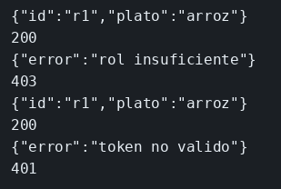

# Laboratorio: quién cambia la receta

El ejemplo de JWT ya separa a quien puede cambiar el artículo de quien solo puede leerlo. Aquí cualquiera lee y cambia el plato. `jsonwebtoken` está instalado, el secreto es `secreto-recetas`, `noa` es `chef`, `ian` es `comensal` y la clave de los dos es `lab`. El trabajo es que el rol lo firme el servidor y que el PUT solo deje pasar al chef.

### Objetivo

`noa` cambia el plato (200). `ian` recibe 403. Sin token, el GET responde 401.

### Punto de partida

```bash
cd labs/M05-seguridad-y-autenticacion/lab-jwt
npm install
npm start
```

```bash
curl -s -X PUT -H 'Content-Type: application/json' -d '{"plato":"pescado"}' http://127.0.0.1:3001/recetas/r1
echo
```

200 y `plato` `pescado`. No hay identidad.

### 1 — Crea `sesion.mjs`

**Acción:** crea `sesion.mjs` con esto.

```js
import jwt from 'jsonwebtoken';

const SECRETO = 'secreto-recetas';
const cuentas = { noa: 'chef', ian: 'comensal' };

export function montarSesion(app) {
  app.post('/sesion', (req, res) => {
    const rol = cuentas[req.body.sub];
    if (!rol || req.body.clave !== 'lab') {
      res.status(401).json({ error: 'credenciales' });
      return;
    }
    const token = jwt.sign({ sub: req.body.sub, rol }, SECRETO, { expiresIn: '15m' });
    res.json({ token });
  });
}

export function exigir(rolExigido) {
  return (req, res, next) => {
    const cabecera = req.header('authorization') || '';
    const token = cabecera.startsWith('Bearer ') ? cabecera.slice(7) : '';
    try {
      const payload = jwt.verify(token, SECRETO);
      if (rolExigido && payload.rol !== rolExigido) {
        res.status(403).json({ error: 'rol insuficiente' });
        return;
      }
      req.usuario = payload;
      next();
    } catch {
      res.status(401).json({ error: 'token no valido' });
    }
  };
}
```

En `server.mjs`, añade el import arriba, llama a `montarSesion(app)` antes de las rutas, y cambia las dos rutas para que pasen por `exigir`.

```js
import { exigir, montarSesion } from './sesion.mjs';
```

```js
montarSesion(app);

app.get('/recetas/r1', exigir(), (req, res) => {
  res.json({ id: 'r1', plato });
});

app.put('/recetas/r1', exigir('chef'), (req, res) => {
  plato = req.body.plato;
  res.json({ id: 'r1', plato });
});
```

Reinicia.

```bash
curl -s -H 'Content-Type: application/json' -d '{"sub":"noa","clave":"lab"}' http://127.0.0.1:3001/sesion
echo
```

**Por qué:** el rol lo pone el servidor al conocer la cuenta. No viene elegido por el cliente. `exigir()` sin argumento solo comprueba la firma. `exigir('chef')` además compara el rol.

**Resultado esperado:** un JSON con `token`. Son tres tramos separados por puntos.

### 2 — Prueba chef, comensal y anónimo

**Acción:** con el servidor ya reiniciado:

```bash
TOKEN=$(curl -s -H 'Content-Type: application/json' -d '{"sub":"noa","clave":"lab"}' http://127.0.0.1:3001/sesion | node -e "let s='';process.stdin.on('data',d=>s+=d).on('end',()=>process.stdout.write(JSON.parse(s).token))")
curl -s -w '\n%{http_code}\n' -X PUT -H "Authorization: Bearer $TOKEN" -H 'Content-Type: application/json' -d '{"plato":"arroz"}' http://127.0.0.1:3001/recetas/r1
TOKEN=$(curl -s -H 'Content-Type: application/json' -d '{"sub":"ian","clave":"lab"}' http://127.0.0.1:3001/sesion | node -e "let s='';process.stdin.on('data',d=>s+=d).on('end',()=>process.stdout.write(JSON.parse(s).token))")
curl -s -w '\n%{http_code}\n' -X PUT -H "Authorization: Bearer $TOKEN" -H 'Content-Type: application/json' -d '{"plato":"nada"}' http://127.0.0.1:3001/recetas/r1
curl -s -w '\n%{http_code}\n' -H "Authorization: Bearer $TOKEN" http://127.0.0.1:3001/recetas/r1
curl -s -w '\n%{http_code}\n' http://127.0.0.1:3001/recetas/r1
```

**Por qué:** 403 es «sé quién eres y esta ruta no es para tu rol». 401 es «no sé quién eres». `ian` puede leer. El plato que lee es el que dejó `noa`.

**Resultado esperado:** 200 `arroz`, 403, 200 con `plato` `arroz` y, sin cabecera, 401.

## Así se ve

`noa` deja el plato en `arroz` (200). `ian` recibe 403 al escribir y 200 al leer ese plato. Sin cabecera, 401.



## Comprueba tu entendimiento

**Un token firmado con otro secreto**
```bash
FALSO=$(node --input-type=module -e "import jwt from 'jsonwebtoken'; process.stdout.write(jwt.sign({sub:'noa',rol:'chef'},'otro',{expiresIn:'15m'}))")
curl -s -w '\n%{http_code}\n' -X PUT -H "Authorization: Bearer $FALSO" -H 'Content-Type: application/json' -d '{"plato":"nada"}' http://127.0.0.1:3001/recetas/r1
```
→ 401. El payload dice `chef` y la firma no es la de `secreto-recetas`.

## Errores frecuentes

| Síntoma | Causa probable | Cómo arreglarlo |
|---------|----------------|-----------------|
| 401 con el token de `noa` | Falta el prefijo `Bearer ` | `Authorization: Bearer ` y el token |
| `ian` recibe 200 en el PUT | La ruta no usa `exigir('chef')` | El GET lleva `exigir()`. El PUT lleva `exigir('chef')` |
