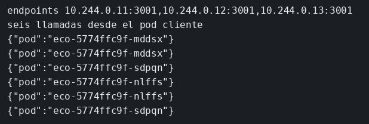

# Laboratorio: el Service no encuentra los Pods

El ejemplo de Kubernetes ya aplica un manifiesto que funciona, con volumen incluido. Aquí la imagen y el Deployment están bien, pero el Service selecciona `app: eco-mal` y los Pods llevan `app: eco`, así que el Service no encuentra a nadie. Primero alineas el selector y miras los endpoints. Después entras por el Service. Luego subes a tres réplicas y, solo entonces, preguntas desde dentro del clúster. kind usa el clúster `ms`. Hasta este módulo, Compose se arrancaba sin mirar el clúster. Esta es la práctica con kind.

El JSON de `/eco` y el selector del Service están en [contrato.json](contrato.json).

### Objetivo

Ver el JSON de `/eco` a través del Service y, con tres réplicas, dos nombres de Pod distintos al preguntar desde dentro del clúster.

### Punto de partida

```bash
bash scripts/limpiar-entorno.sh
cd labs/M06-docker-y-kubernetes/lab-kind
docker build -t ms-eco-lab:lab .
kind create cluster --name ms
kind load docker-image ms-eco-lab:lab --name ms
kubectl apply -f k8s.yaml
kubectl rollout status deployment/eco
kubectl get endpoints eco
```

El Deployment llega a Ready. `ENDPOINTS` está vacío: el selector no coincide.

### 1 — Alinea el selector

**Acción:** en `k8s.yaml`, el `selector` del Service pasa de `app: eco-mal` a `app: eco`.

```yaml
  # La misma etiqueta que llevan los Pods en el template.
  selector:
    app: eco
```

```bash
kubectl apply -f k8s.yaml
kubectl get endpoints eco
```

**Por qué:** el Service no busca por nombre de Deployment. Busca Pods con esas etiquetas. La etiqueta del Pod ya era `app: eco`.

**Resultado esperado:** una IP y el puerto 3001. Sigue habiendo un solo Pod: `replicas` está en 1.

### 2 — Entra por el Service

**Acción:**

```bash
kubectl port-forward svc/eco 3001:3001
```

En otra terminal: `curl -s http://127.0.0.1:3001/eco`.

La misma petición está en `peticiones.http`. Ábrelo y pulsa Send Request encima (extensión REST Client). El `port-forward` tiene que seguir abierto.

**Por qué:** el puerto 3001 del host no está publicado por un Service de tipo NodePort. El forward es el túnel de esta práctica, y apunta al Service, que ya tiene un endpoint.

**Resultado esperado:** `{"pod":"eco-..."}`. Para el forward con Ctrl+C cuando hayas visto el JSON.

### 3 — Tres réplicas

**Acción:** en `k8s.yaml` sustituye `replicas` por esto.

```yaml
  # Tres Pods con la misma etiqueta. El Service los suma a sus endpoints.
  replicas: 3
```

```bash
kubectl apply -f k8s.yaml
kubectl rollout status deployment/eco
kubectl get pods -l app=eco
kubectl get endpoints eco
```

**Por qué:** el selector no cambia. El Deployment mantiene tres Pods con `app: eco`, y el Service los suma todos a sus endpoints. Desde tu terminal, `port-forward` se queda en uno de ellos: el reparto se ve en el paso siguiente, desde dentro.

**Resultado esperado:** tres Pods `Running` y tres direcciones en `ENDPOINTS`.

### 4 — Preguntar desde un Pod

**Acción:** crea `desde-dentro.yaml` con esto.

```yaml
# Un Pod de un solo uso. Desde dentro del clúster el nombre `eco`
# es el Service, y el Service reparte entre los Pods. Por eso las
# respuestas no tienen por qué traer el mismo hostname.
apiVersion: v1
kind: Pod
metadata:
  name: cliente
spec:
  restartPolicy: Never
  containers:
    - name: curl
      image: curlimages/curl
      command: ["sh", "-c", "for i in 1 2 3 4 5 6; do curl -s http://eco:3001/eco; echo; done"]
```

```bash
kubectl delete pod cliente --ignore-not-found
kubectl apply -f desde-dentro.yaml
kubectl wait --for=jsonpath='{.status.phase}'=Succeeded pod/cliente
kubectl logs cliente
```

**Por qué:** seis preguntas al mismo nombre `eco`. Con un solo endpoint las seis líneas repetirían el mismo Pod. Con tres, el Service reparte.

**Resultado esperado:** seis líneas y, entre ellas, al menos dos valores de `pod`.

El HPA y Helm están en `ejemplos/06-helm`. El volumen que sobrevive al Pod está en `ejemplos/06-kubernetes`.

## Así se ve

El Service tiene endpoints y, entre las seis líneas, aparecen al menos dos nombres de Pod.



## Comprueba tu entendimiento

**Volver a romper el selector**
Cambia otra vez a `app: eco-mal`, aplica y `kubectl get endpoints eco`.
→ La lista queda vacía. Los Pods siguen Running. Nadie les envía tráfico por el Service.

## Reto

### 1 — Otra vez una réplica

Con el selector otra vez en `app: eco`, deja el Deployment en un solo Pod y comprueba cuántas direcciones publica el Service.

<details>
<summary>Ver solución</summary>

```bash
kubectl scale deployment/eco --replicas=1
kubectl rollout status deployment/eco
kubectl get endpoints eco
```

`ENDPOINTS` muestra una sola IP y el puerto 3001. El selector sigue en `app: eco`. Lo que bajó es el número de Pods que cumplen esa etiqueta. Si quieres que el manifiesto coincida, deja también `replicas: 1` en `k8s.yaml`.

</details>

## Errores frecuentes

| Síntoma | Causa probable | Cómo arreglarlo |
|---------|----------------|-----------------|
| `ImagePullBackOff` | La imagen no se cargó en kind | `kind load docker-image ms-eco-lab:lab --name ms` y borra el Pod |
| `endpoints` vacío después del paso 1 | El apply no cogió el fichero, o la etiqueta del Pod no es `app: eco` | `kubectl get pods --show-labels` |
| Tres Pods y un solo nombre en los logs | `replicas` se aplicó y el Pod `cliente` se lanzó antes del rollout | `kubectl rollout status deployment/eco`, borra `cliente` y vuelve a aplicar `desde-dentro.yaml` |
