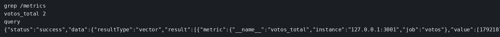

# Laboratorio: un contador que Prometheus pueda rascar

El ejemplo de Prometheus ya trae `/metrics`, Grafana y una alerta. Aquí el POST suma una variable y no hay `/metrics`. El compose de Prometheus ya apunta a tu puerto 3001. Jaeger y los logs se miran en sus ejemplos: este laboratorio es solo la métrica.

### Objetivo

Tras dos POST, la query `votos_total` en Prometheus vale 2.

### Punto de partida

```bash
bash scripts/limpiar-entorno.sh
cd labs/M07-monitorizacion-y-logging/lab-metricas
npm install
npm start
```

En otra terminal, desde esta carpeta:

```bash
docker compose up -d
curl -s -X POST http://127.0.0.1:3001/votos; echo
curl -s -o /dev/null -w '%{http_code}\n' http://127.0.0.1:3001/metrics
```

El POST devuelve `{"votos":1}`. `/metrics` responde 404.

### 1 — Crea `metricas.mjs` y cuenta en el POST

**Acción:** crea `metricas.mjs` con esto.

```js
import client from 'prom-client';

const registro = new client.Registry();
export const votosTotal = new client.Counter({
  name: 'votos_total',
  help: 'Votos recibidos',
  registers: [registro],
});

export function montarMetricas(app) {
  app.get('/metrics', async (req, res) => {
    res.set('Content-Type', registro.contentType);
    res.end(await registro.metrics());
  });
}
```

En `server.mjs`, añade el import arriba, llama a `montarMetricas(app)` antes de `listen`, y dentro del POST, junto a `votos += 1`, añade `votosTotal.inc()`.

```js
import { montarMetricas, votosTotal } from './metricas.mjs';
```

```js
votosTotal.inc();
```

```js
montarMetricas(app);
```

Reinicia `npm start`. La variable `votos` sigue en el JSON del POST. Prometheus no la lee: lee `votos_total`. Haz dos POST.

```bash
curl -s http://127.0.0.1:3001/metrics | grep votos_total
```

**Por qué:** Prometheus no lee la variable `votos`. Lee el texto de `/metrics`.

**Resultado esperado:** una línea `votos_total 2` (o el número de POST que hayas hecho desde el reinicio).

### 2 — Pregunta a Prometheus

**Acción:**

```bash
until curl -sf http://127.0.0.1:9090/-/ready; do sleep 2; done
curl -s 'http://127.0.0.1:9090/api/v1/query?query=votos_total'
echo
```

**Por qué:** el raspado es lo que saca el número del proceso. La query es la prueba de que Prometheus, en la red del host, llega a `127.0.0.1:3001`.

**Resultado esperado:** un `"value"` cuyo segundo elemento es `"2"`. Puede tardar un raspado (unos segundos) si acabas de reiniciar.

## Así se ve

`/metrics` trae `votos_total 2`. La query de Prometheus devuelve ese mismo `"2"`.



## Comprueba tu entendimiento

**Parar el proceso no borra la serie al instante**
Ctrl+C en el servidor y repite la query.
→ Sigue apareciendo el último valor, y `up{job="votos"}` pasa a `0` en el siguiente raspado. Arranca otra vez `npm start` si vas a seguir.

## Errores frecuentes

| Síntoma | Causa probable | Cómo arreglarlo |
|---------|----------------|-----------------|
| La query no trae `result` | `/metrics` no existe o Prometheus no está en la red del host | `curl` local a `/metrics` primero. El compose usa `network_mode: host` |
| `votos_total` no está en `/metrics` | El contador no se registró en `registro` | `registers: [registro]` y la ruta usa `registro.metrics()` |
